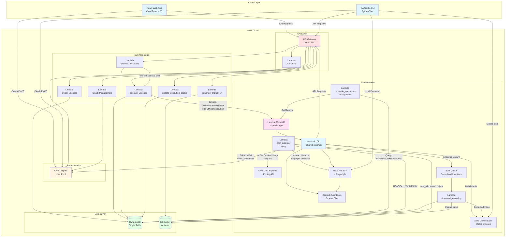
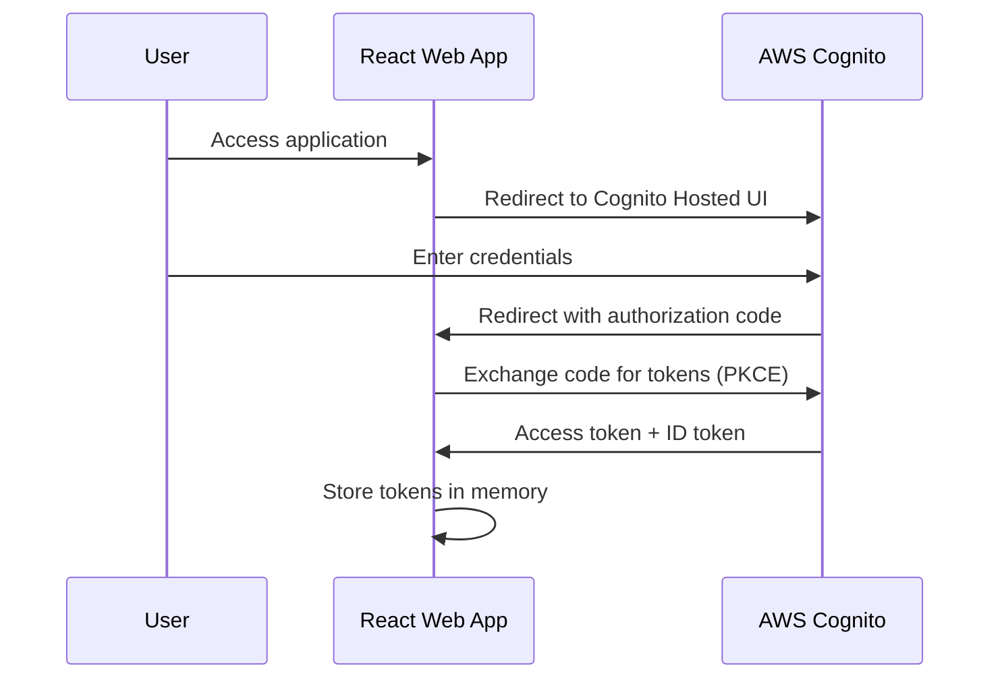
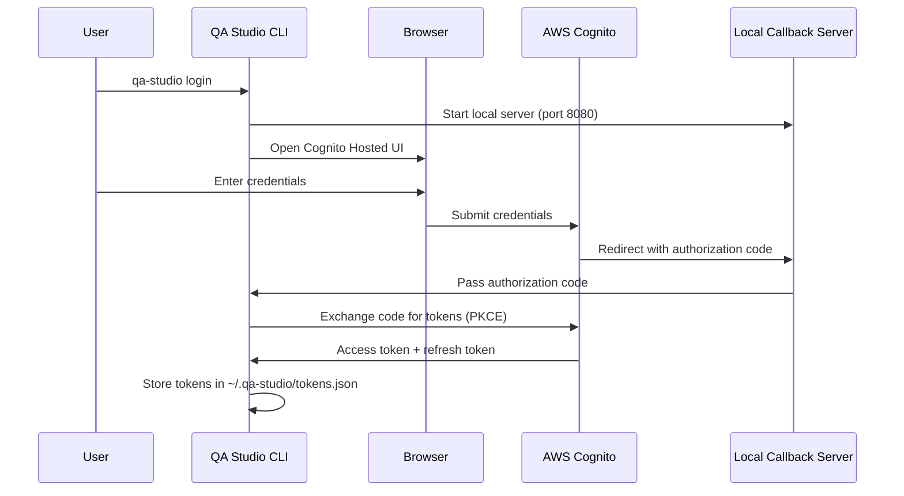
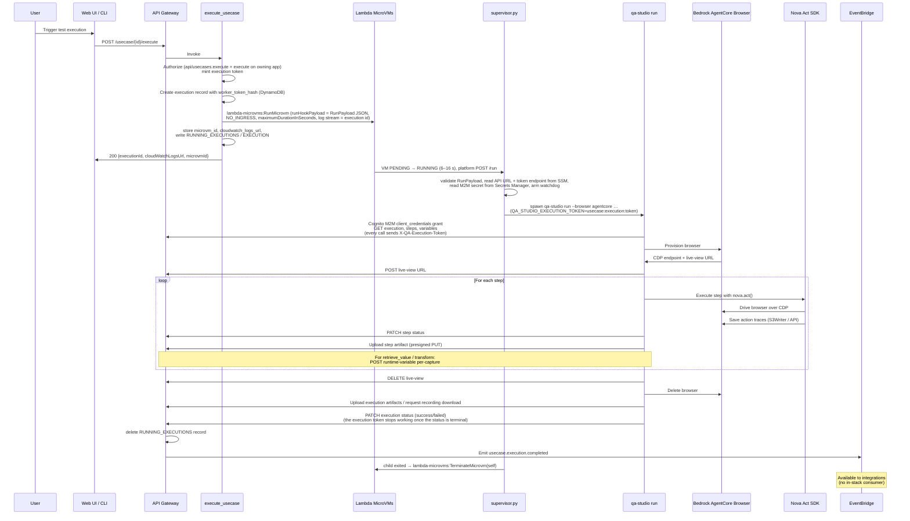
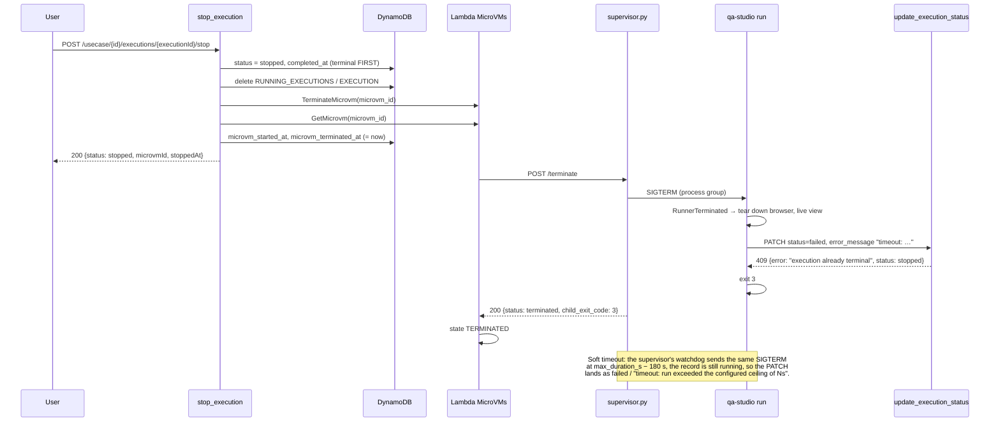
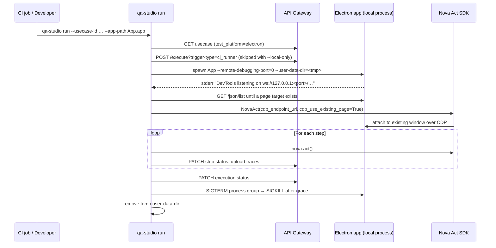
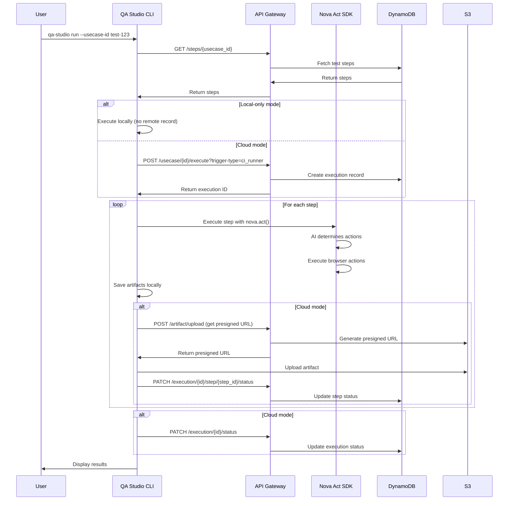
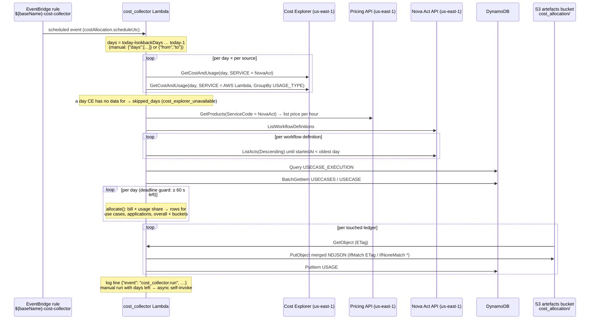
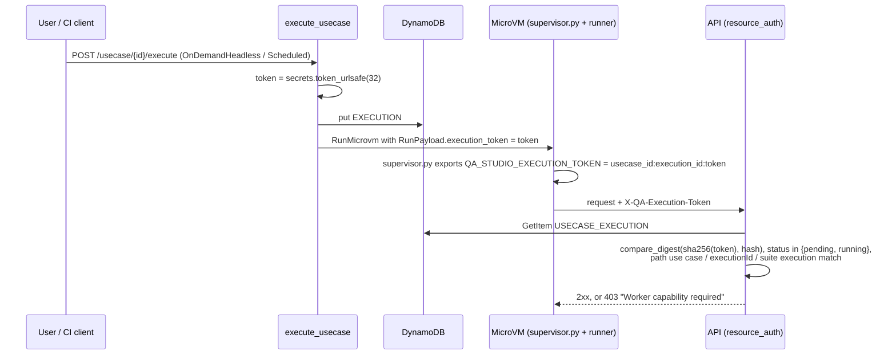

# Architecture Overview

## System Overview

QA Studio is a serverless web application for AI-powered automated testing built on Amazon Nova Act. The system consists of a React frontend, serverless API backend, a cloud test execution worker (one Lambda MicroVM per execution or wizard session), and a CLI tool. The `qa-studio` CLI is the single execution runtime: developer-run tests, CI-run tests, and cloud-triggered worker tests all invoke the same code path.

**Key Capabilities**:
- Natural language test creation and management
- AI-powered browser automation with Amazon Nova Act
- Mobile app testing on real devices via AWS Device Farm
- Electron desktop app testing through the CI runner (app launched locally, driven over CDP)
- Interactive test wizard with live browser preview
- Test suite organization and execution
- Comprehensive artifact capture (videos, screenshots, logs, traces)
- OAuth 2.0 authentication for users and API clients
- CLI tool for local test execution and management, and as the runtime for the cloud worker

---

## System Components



> **Note on the cloud worker**: every cloud execution runs on its own Lambda MicroVM cloned from one image (`web-app/worker/Dockerfile`). `supervisor.py` is the image entrypoint: it answers the platform's lifecycle hooks and spawns `qa-studio run --browser agentcore …` (batch) or `wizard_worker.py` (wizard) from the `/run` payload. The runner authenticates against Cognito using an M2M client whose credentials live in Secrets Manager and writes all state back through the public API — the worker does not talk to DynamoDB, S3, SQS or EventBridge directly for batch executions. `execute_usecase` launches one VM per execution; there is no execution queue (the use-case-level `OnDemand` SQS trigger was removed; the suite-level `OnDemand` trigger fans out to `OnDemandHeadless` per use case). Wizard sessions run on the same image with `mode: wizard` and the legacy `wizard_worker.py` path until the wizard migration lands. The `web-app/worker/` Python modules are exactly the ones `wizard_worker.py` imports plus the supervisor; the old batch `worker.py` and its exclusive modules are gone. There is no ECS cluster or container registry in the stacks any more and the worker VM is never in a VPC (the "Removed keys" table in [Configuration](configuration.md#removed-keys) lists the settings that went with them). Only the AgentCore browser can be VPC-attached, when `vpcId` is configured ([Configuration → AgentCore browsers in a VPC](configuration.md#agentcore-browsers-in-a-vpc)).

---

## Data Flow Diagrams

### Web UI Authentication Flow



### CLI Authentication Flow



### Test Execution Flow (Cloud)

`execute_usecase` starts one Lambda MicroVM per execution; everything from `qa-studio run` onwards is identical to a local or CI run.



Measured on the dev environment: `RunMicrovm` returns in ~0.2 s, `PENDING → RUNNING` takes 6–16 s, a single web use case is `success` about 90 s after the API call, and a suite of 20 use cases has all 20 VMs started within 15.7 s (paced by the sequential `execute_usecase` calls of the suite Lambda, not by the platform).

#### Stop and timeout paths



The supervisor spawns every batch child with `QA_STUDIO_TERMINATION_REASON=timeout`, because inside a VM the only two SIGTERM sources are the watchdog and `/terminate`, and `stop_execution` makes the record terminal before `/terminate` can be reached. The runner therefore always reports `timeout:` and exits `3` in a VM; the `terminated:` message and exit code `143` are what a CI job or a `docker stop` gets (see [CI/CD integration → Exit codes](ci-cd-integration.md#exit-codes)).

Three layers bound a MicroVM execution (design §7): (a) the supervisor's soft timeout 180 s before the ceiling, which lets the runner report `failed` / `timeout:` and clean up; (b) the platform's `maximumDurationInSeconds` (= `maxExecutionDurationMinutes × 60`), which kills the VM and posts `/terminate` first; (c) the reconciler below, for anything that slips both. Because the platform's idle policy cannot be disabled, the launch sets `idlePolicy.maxIdleDurationSeconds` to the same ceiling, so a VM with no inbound traffic (there never is any: `NO_INGRESS`) is never suspended mid-test. Measured on dev: the record is `stopped` within the API call, the VM is `TERMINATING` ~6 s later and `TERMINATED` ~22 s after the stop.

**Wizard sessions** follow the same shape with `mode: wizard` (`start_wizard_session` → `RunMicrovm`, ceiling `maxWizardSessionMinutes × 60`, `RUNNING_EXECUTIONS` record with `mode = wizard`). `terminate_wizard_session` writes the terminal `success` first, sends the `terminate` command, then calls `TerminateMicrovm`; `wizard_worker.py` turns the resulting SIGTERM into `SystemExit(143)` so its browser cleanup runs without writing `failed`. The 30-minute inactivity timeout writes `timeout`, which is terminal, so the reconciler only drops the tracking record. Details: [worker README → Wizard mode](../web-app/worker/README.md#wizard-mode).

### Test Execution Flow (Electron, CI runner)



Electron usecases never reach the cloud worker: `execute_usecase` / `execute_test_suite` return `400` for any trigger other than `ci_runner`. Video recording and trajectory replay are off for this platform (Nova Act cannot record over CDP).

### Test Execution Flow (Local CLI)



---

## Component Details

### Frontend (React Web App)

**Technology**: React 19, TypeScript, Vite, AWS Cloudscape Design System

**Hosting**: CloudFront (CDN) + S3 (static hosting)

**Key Features**:
- Test creation and management UI
- Interactive test wizard with live browser preview
- Test suite organization
- Execution history and artifact viewing
- OAuth client management
- User management

**Shared building blocks** (`web-app/frontend/src`). Reuse these before writing another copy:

| Module | Used by | What it does |
|--------|---------|--------------|
| `hooks/useApiList.ts` | `useTeams`, `useUsers`, `useTeamMembers`, `useSharedAccess` | Loads a JSON array from `GET path` (`null` path = don't fetch); only the latest request writes state |
| `components/common/AddItemsPicker.tsx` (+ `usecasePickerColumns.tsx`) | Add use cases to a suite / application, add test suites to an application | Searchable multi-select table; rows already in the target are disabled |
| `components/common/KeyValueManager.tsx` | Headers and Secrets tabs of a use case, application Secrets page | Key/value list with add, delete and save through an API adapter; `masked` for secrets. `ownerSource` + `readOnlyRowLabel` render rows from another layer (e.g. application secrets on a use case) read-only with a badge; `readOnly` hides the editor; `labels.emptyText` is the empty-state text. `SecretsManager.secretsApi(path)` builds the adapter for `usecase/{id}/secrets` and `applications/{id}/secrets` |
| `components/common/VariablesEditor.tsx` | Use-case Variables card, application Variables page | Key/value `AttributeEditor` with save/reset through a `VariablesApi {list, save}` adapter (`variablesApi(path)`). Rows whose `source` differs from the owner are listed read-only under *Inherited from application* with an *Application* badge and are never sent back on save; a draft with an inherited key shows *Overrides application value* |
| `components/applications/applicationNav.ts` | `App.tsx` side navigation, `ApplicationDetailView` Actions → Configuration, `ApplicationConfigPage` breadcrumbs | One list of the per-application config pages (`variables`, `secrets`, `datasets`) and the *Applications* `expandable-link-group` whose children appear only on `/applications/:id/*` |
| `components/applications/ApplicationConfigPage.tsx` | `ApplicationVariablesPage`, `ApplicationSecretsPage`, `ApplicationDatasetsPage` | Page shell: loads the application, breadcrumbs *Applications → name → page*, `readOnly = !canManageApplication(...)` (team lead of the owning team or admin) passed to the child |
| `components/usecase/RepeatDatasetEditor.tsx` | `StepFormModal` (inline repeat rows), `DatasetFormModal` (application datasets) | Columns + rows grid with CSV paste; same validation as the server (`repeatDatasetArgs.ts`) |
| `components/common/DeleteConfirmModal.tsx` | Batch delete of use cases and executions; `TypedDeleteModal` for templates | "Type *permanently delete*" confirmation |
| `components/common/FormModal.tsx` | Admin modals (create team/user, add member, grant access) | Modal shell: submit/cancel, submitting state, error, reset on close |
| `components/usecase/stepDetails.ts` | `WorkflowStepsCard` | Per-step-type detail lines |
| `components/unified-wizard/steps/SourcePicker.tsx`, `unified-wizard/sourceDetail.ts` | Wizard clone and template steps | Source Select + preview; use case / template detail loaders |
| `utils/time.ts`, `utils/executionStatus.ts`, `components/usecase/operatorText.ts` | Lists, status indicators, step details | Relative time, execution status → StatusIndicator type, validation operator text |

`npm run lint:dead` (knip) reports unused files, exports and dependencies; see [Development](development.md#frontend-dead-code-check).

**Authentication**: OAuth 2.0 PKCE flow via Cognito Hosted UI

### CLI Tool (QA Studio CLI)

**Technology**: Python 3.11+, Click framework

**Installation**: `pip install -e ./qa-studio-cli[runner]`

**Key Features**:
- Browser-based OAuth authentication
- Test and suite management commands
- Local test execution with Nova Act (web, mobile and Electron)
- Mobile test execution via AWS Device Farm
- Electron desktop execution: launches the app with a loopback DevTools port and attaches over CDP (`runner/browser/electron.py`)
- Configuration management
- Kiro IDE integration

**Authentication**: OAuth 2.0 PKCE flow with local callback server

### API Layer

**Technology**: Amazon API Gateway (REST API) + AWS Lambda (Python 3.11)

**Authentication**: 
- Lambda authorizer validates JWT tokens from Cognito and injects the caller identity (user, OAuth client or worker, with team roles)
- Scope-based authorization (e.g., `api/usecases.read`, `api/usecases.write`) plus team ownership on every resource route through `require_resource_access` (see [Authorization](#authorization))

**Key Endpoints**:
- `/usecases` - Test management (CRUD)
- `/applications` - Applications and their shared configuration (variables, secrets, datasets) — every `/applications/{proxy+}` route is dispatched by one Lambda, `application_router` (see [Application-level configuration](#application-level-configuration))
- `/steps` - Test step management
- `/suites` - Test suite management
- `/executions` - Execution management and triggering
- `/devices` - Device Farm device listing
- `/oauth-clients` - OAuth client management
- `/artifacts` - Artifact URL generation

### Test Execution (Cloud worker: Lambda MicroVM)

**Technology**: one container image (`web-app/worker/Dockerfile`, Python 3.13, ARM64) carrying the `qa-studio` CLI (`[runner,agentcore]` extras), Nova Act SDK, Playwright and Appium (mobile). Browser execution runs in Bedrock AgentCore, not inside the worker. The image is an `AWS::Lambda::MicrovmImage`; `execute_usecase` and `start_wizard_session` launch one **Lambda MicroVM** from it per execution or wizard session. ECS Fargate, the container registry and the VPC that hosted the previous worker were removed. Without `vpcId` the stacks carry no network resources; with `vpcId` the worker stack only looks the VPC up and adds at most one security group for the browser ENIs (`lib/browser-vpc.ts`).

**Trigger**: `execute_usecase` for `OnDemandHeadless` and `Scheduled`; `execute_test_suite` calls it once per use case. `ci_runner` creates the record only. There is no queue in between.

| | Lambda MicroVM |
|---|---|
| Launch call | `lambda-microvms:RunMicrovm` (`lambdas/endpoints/microvm_launch.py`) with a `RunPayload` JSON string as `runHookPayload` (≤ 4096 bytes) |
| Per-execution input | `RunPayload` (`web-app/worker/supervisor_models.py`, mirrored in `lambdas/endpoints/run_payload.py`) — see [worker README](../web-app/worker/README.md#runpayload-supervisor_modelspy) |
| Stack constants | image-level env baked into the snapshot (never per-execution, never secret) |
| M2M credentials | the supervisor reads the Secrets Manager secret at `/run` under the VM execution role |
| Process in the image | `supervisor.py` (image `ENTRYPOINT`) spawns `qa-studio run` (batch) or `wizard_worker.py` (wizard) in its own process group |
| Network | ingress connector `arn:aws:lambda:<region>:aws:network-connector:aws-network-connector:NO_INGRESS` (omitting it yields `HTTP_INGRESS`), default internet egress; the VM is never in a VPC. AgentCore browsers use `PUBLIC` network mode by default and `VPC` mode (ENIs in the selected subnets of the imported VPC, image env `AGENT_CORE_VPC` / `AC_*`) when config `vpcId` is set |
| Identifiers on the execution record | `microvm_id`, `cloudwatch_logs_url`; at the terminal transition `microvm_started_at` / `microvm_terminated_at` from `GetMicrovm` (cost allocation) |
| Logs | `/qa-studio/<baseName>/microvm`, stream `<execution_id>` (image builds: `<version>/<build-id>`) |
| Stop | `stopped` written first, then `TerminateMicrovm` → `/terminate` → SIGTERM; the runner's late `failed` PATCH gets `409` |
| Run ceiling | `maximumDurationInSeconds = maxExecutionDurationMinutes × 60` (default 60 min, max 480; wizard: `maxWizardSessionMinutes`, default 240); supervisor soft timeout at ceiling − 180 s; `idlePolicy.maxIdleDurationSeconds` = the same ceiling |
| Crash / orphan detection | `RUNNING_EXECUTIONS` record + `reconcile_executions` (below) |
| Startup | `RunMicrovm` returns in ~0.2 s, `PENDING → RUNNING` in 6–16 s |
| Launch throttling | `RunMicrovm` quota 5/s, burst 5: `ThrottlingException` retried 5× with exponential backoff (1, 2, 4, 8 s) |
| IAM | build role (`s3:GetObject` on the code artifact, logs), VM execution role (worker permission set + M2M secret read + `TerminateMicrovm`/`GetMicrovm` on the image ARN); `execute_usecase` / `start_wizard_session` get `RunMicrovm`/`GetMicrovmImage`, `lambda:PassNetworkConnector` on the managed connector ARNs and `iam:PassRole` |
| Stack size | worker stack 118 CloudFormation resources, lambdas stack 399 / 500 |

**MicroVM image** (`lib/worker-stack.ts`, `AWS::Lambda::MicrovmImage`, `aws-cdk-lib` 2.275.0 / `aws-cdk` 2.1146.1): built by Lambda from an S3 zip of the `.dockerignore`-filtered repo root with the Dockerfile at the zip root (`lib/worker-image-asset.ts`, a local file copy — **no Docker or Podman on the deploying machine**), on the managed base `arn:aws:lambda:<region>:aws:microvm-image:al2023-1` v2, `ARM_64`, 1024 MiB minimum memory, hooks on port 8080 (`run`/`terminate` 60 s, `ready` 600 s, `validate` 120 s; `suspend`/`resume` disabled). The build takes 3–5 min and CloudFormation waits for it on every worker deploy whose `web-app/worker/` or `qa-studio-cli/` sources changed. `AWS_REGION` is a reserved key the platform injects (with `AWS_DEFAULT_REGION`, `AWS_LAMBDA_MICROVM_IMAGE_*`) and must not be set at image level. Lambda and worker `boto3`/`botocore` are pinned ≥ 1.43.35, the first release with the `lambda-microvms` client.

**Container contract**:
- The worker image installs the `qa-studio` CLI from the sibling `qa-studio-cli/` package during the image build.
- `supervisor.py` is the `ENTRYPOINT`. `/run` validates the `RunPayload`, resolves the API URL and Cognito token endpoint from SSM and the M2M credentials from Secrets Manager in-process, then spawns the child selected by `mode`: `qa-studio run --browser agentcore …` for `batch`, `python wizard_worker.py` for `wizard` (until the wizard migration lands). Hook table, payload table and watchdog: [worker README](../web-app/worker/README.md#microvm-supervisor).

**Execution Flow (Web, batch mode)**:
1. The supervisor resolves `QA_STUDIO_API_URL` (SSM) and `OAUTH_TOKEN_ENDPOINT` (SSM), exports `OAUTH_CLIENT_ID` / `OAUTH_CLIENT_SECRET`, and exports `QA_STUDIO_EXECUTION_TOKEN="{usecase_id}:{execution_id}:{token}"` from `RunPayload.execution_token`.
2. `qa-studio run --browser agentcore --format json --verbose --region $AWS_REGION` starts.
3. The CLI authenticates via Cognito M2M client-credentials and fetches execution details over the public API.
4. The AgentCore browser provisioner calls Bedrock to create + start a remote browser, returns CDP endpoint + live-view URL.
5. The runner publishes the live-view URL via the `live-view` endpoint so the frontend can show it.
6. For each step, the runner executes via NovaAct, posts step status + uploads artifacts via presigned PUT URLs, and (for `retrieve_value` / `transform` steps) publishes captured runtime variables per-capture.
7. The AgentCore browser + live-view record are torn down in the runner's `finally` block — also on SIGTERM (`qa_studio_cli/runner/termination.py` turns it into `RunnerTerminated`; `deadline.run_bounded` gives the run 10 s to stop cooperatively, then hard-stops).
8. The runner uploads execution artifacts (and, for mobile, requests the recording download), then PATCHes the final execution status — the server-side `update_execution_status` Lambda emits the `usecase.execution.completed` EventBridge event and deletes the `RUNNING_EXECUTIONS` record. The order matters: the [worker execution token](#worker-execution-capability) is only valid while the execution is `pending` or `running`. The supervisor then calls `TerminateMicrovm` on its own VM.

Every API call in steps 3-8 carries `X-QA-Execution-Token` (from `QA_STUDIO_EXECUTION_TOKEN`).

**Execution Flow (Mobile, batch mode)**:
1. Steps 1-3 as above.
2. Instead of provisioning an AgentCore browser, the CLI builds a `DeviceFarmActuator` and hands it to NovaAct (uploads the app binary to Device Farm if needed).
3. After the Device Farm session starts, the runner persists the session ARN via the `mobile-metadata` endpoint so the frontend can link to Device Farm.
4. Steps execute via the actuator; all state writes go through the API.
5. After the session stops, the runner posts the final session ARN and calls the `download-recording` endpoint which enqueues a delayed SQS message (5 min) for the recording download Lambda.

**Recording Download (Mobile)**:
- The `download_device_farm_recording` Lambda picks up the delayed SQS message, waits for the session to reach a terminal state, downloads the video, uploads it to S3, and creates a DynamoDB artifact record.
- If the session hasn't finalized yet, the Lambda raises an error and SQS retries after the visibility timeout (3 min), up to 10 retries.

**Event Emission**:
- `usecase.execution.completed` is emitted by the `update_execution_status` Lambda (`Source=qa-studio.api`) on every terminal status transition.
- Event detail: `usecase_id`, `execution_id`, `execution_status`, `timestamp`.
- No rule in the stacks consumes it any more (the bbox `cache_builder_rule` was removed, and it only matched `Source=qa-studio.worker`, which nothing emits). It stays on the bus for integrations. The execution aggregation and last-execution rules consume `nova-act-qa-studio.execution.status.changed`.
- The MicroVM runtime adds **no new events**: the reconciler marks executions `failed` through the same terminal transition, so integrations see the same `nova-act-qa-studio.execution.status.changed` message (with `error_message` starting `reconciler:`).

**Terminal-state guard** (`update_execution_status`): once an execution is `success`, `failed`, `stopped`, `error` or `completed`, a PATCH with a *different* status returns `409 {"error": "execution already terminal", "status": "<current>"}` and writes nothing; a PATCH repeating the same terminal status is an idempotent `200`. This is what lets `stop_execution` write `stopped` before terminating the worker and still end up with `stopped`, not the runner's `failed`.

**Execution reconciler** — `reconcile_executions` Lambda in the worker stack, invoked by an EventBridge schedule every 5 minutes. It is the only crash detector: the platform emits no "VM stopped" event.

| Step | Behaviour |
|---|---|
| Discover | `Query pk = RUNNING_EXECUTIONS` (`running_executions.list_running_executions`; one bounded partition, never a scan). |
| Inspect | `lambda-microvms:GetMicrovm(microvm_id)` per record. |
| Decide | VM `state = TERMINATED`, `ResourceNotFoundException`, or `now > deadline` (= `started_at` + the launch's ceiling — `maxExecutionDurationMinutes` or `maxWizardSessionMinutes` — + 10 min) → the execution is orphaned. |
| Act | If the execution record is still non-terminal: mark it `failed` with `error_message = "reconciler: <reason>"` through the same terminal-transition code the status API uses (EventBridge event, suite counters, cache cleanup, tracking record deleted). If it is already terminal: only the stale tracking record is deleted. |
| Report | CloudWatch metrics in namespace `QAStudio/Worker`: `RunningMicrovms` (tracking records found) and `ReconciledExecutions` (executions marked failed in this run). |
| Alarm | `ReconciledExecutions` Sum > 0 over a 5-minute period → the worker stack's notification SNS topic. |

Steady state is `ReconciledExecutions = 0`: the runner reports its own result, and the supervisor's soft timeout reports `timeout`. Any alarm means a VM died without the runner reporting (image crash, `/run` rejected after the record was written, platform kill without `/terminate`) and is a bug signal, not routine noise. Verified on dev: a `/run` that returned 500 left the execution `pending`; the reconciler marked it `failed` / `reconciler: microvm TERMINATED` within 3 minutes and the alarm fired. Wizard sessions are tracked the same way (`mode = wizard`).

**Artifacts Generated**:
- Screenshots (PNG)
- Videos (MP4) — from AgentCore Browser (web) or Device Farm (mobile)
- Action traces (JSON and HTML)
- Execution logs (text)
- Trajectory JSONs (web) — persisted per step by the runner so subsequent runs can replay them without hitting Nova Act's LLM.

### Data Storage

**DynamoDB (Single Table Design)**:
- Primary Key: `pk` (partition key)
- Sort Key: `sk` (sort key)
- Access patterns optimized with GSIs

**Key Record Types**:
- `USECASE#{id}` / `METADATA` - Test metadata (`test_platform`: `web` | `mobile` | `electron`)
- `USECASE#{id}` / `STEP#{id}` - Test steps. A `repeat` step stores its dataset inline (`repeat_columns`, `repeat_rows`) **or** references an application dataset through `dataset_id` (exactly one of the two; see [Application-level configuration](#application-level-configuration)); its children are ordinary STEP# records with `parent_step_id` = the repeat's `id` (one nesting level, `sort` stays a single global sequence). Steps copied from a template carry `template_id` (S), `template_step_id` (S) and `template_version` (N) — written by `POST /usecase/{id}/import-template` and by `POST /import` when the export JSON contains `step_type: "template"` placeholder steps (expanded server-side by `lambdas/endpoints/template_expansion.py`).
- `TEMPLATES` / `TEMPLATE#{id}` - Template metadata (`version` bumps on every metadata or step change); `TEMPLATE#{id}` / `STEP#{uuid}` template steps; `TEMPLATE#{id}` / `VARIABLES` template variables. `POST /templates/import` writes all three in one batch; `PUT /templates/{id}` replaces steps (matched by `id`), metadata and variables in one transaction.
- `TEMPLATE#{id}` / `USAGE#{usecase_id}` - Template usage: "this use case has at least one step linked to this template" (`template_id` S, `usecase_id` S, `created_at` S). See [Template usage tracking](#template-usage-tracking).
- `USECASE_EXECUTION#{usecase_id}` / `EXECUTION#{id}` - Execution records
- `EXECUTION#{id}` / `EXECUTION_STEP#{id}` - Execution step records. Built by `lambdas/endpoints/execution_steps.py` at execution-creation time: repeat steps are unrolled there (`repeat_expansion.py`) into `rows × children` flat records carrying `repeat_step_id`, `repeat_label`, `repeat_row_index`, `repeat_row_total`, `row_variables`; the runner never sees a repeat. Written with `batch_write_item`.
- `SUITE#{id}` / `METADATA` - Suite metadata
- `SUITE#{id}` / `USECASE#{id}` - Suite-usecase mappings
- `APPLICATION#{id}` / `METADATA` - Application metadata (`name`, `base_url`, `owner_team_id`); `APPLICATION#{id}` / `USECASE#{usecase_id}` - application-usecase association
- `APPLICATION#{id}` / `VARIABLES` - Application-level variables, inherited by every use case of the application
- `APPLICATION#{id}` / `DATASET#{dataset_id}` - Application dataset (named columns + rows table referenced by repeat steps)
- `USAGE#OVERALL`, `USAGE#APPLICATION#{application_id}`, `USAGE#USECASE#{usecase_id}` / `SUMMARY` - Cost allocation summary per dimension (see [Cost allocation](#cost-allocation)); the daily figures live in S3, not in DynamoDB
- `RUNNING_EXECUTIONS` / `EXECUTION#{execution_id}` - In-flight MicroVM execution or wizard session (see table below). Written by `execute_usecase` / `start_wizard_session` right after a successful `RunMicrovm` (best-effort: a failed write is logged, the launch still succeeds), deleted on every terminal transition (`update_execution_status`, `stop_execution`, `terminate_wizard_session`, the reconciler). The partition is bounded by the MicroVM concurrency quota, so the reconciler queries it instead of scanning the table.

**Running-execution tracking** (`lambdas/endpoints/running_executions.py`, pydantic `RunningExecutionRecord`; unknown attributes are ignored on read, writes always go through the model):

| Record (`pk` / `sk`) | Attribute | Type | Description |
|---|---|---|---|
| `RUNNING_EXECUTIONS` / `EXECUTION#{execution_id}` | `usecase_id` | String | Owning use case (the execution record lives at `USECASE_EXECUTION#{usecase_id}` / `EXECUTION#{execution_id}`). |
| | `microvm_id` | String | `RunMicrovm` identifier; the reconciler calls `GetMicrovm` with it, `stop_execution` calls `TerminateMicrovm`. |
| | `mode` | String (`batch` \| `wizard`) | Run-hook payload mode the VM was launched with (`execute_usecase` → `batch`, `start_wizard_session` → `wizard`). |
| | `started_at` | String (RFC3339 `YYYY-MM-DDTHH:MM:SSZ`) | Launch time. |
| | `deadline` | String (RFC3339) | `started_at` + the VM's `maximumDurationInSeconds` (`maxExecutionDurationMinutes` for batch, `maxWizardSessionMinutes` for wizard) + 10 min grace (`DEADLINE_GRACE`); past it the reconciler treats the execution as overdue. |
| | `suite_execution_id` | String | Optional; present only for suite fan-out executions. |

**MicroVM attributes on the execution record** (`USECASE_EXECUTION#{usecase_id}` / `EXECUTION#{execution_id}`, written by `execute_usecase` / `start_wizard_session` after the launch; records created before the MicroVM runner carry `task_arn` / `task_id` instead and are all terminal — `stop_execution` rejects them with `400`):

| Attribute | Type | Description |
|---|---|---|
| `microvm_id` | String | The VM's identifier (`RunMicrovm` response); `stop_execution` / `terminate_wizard_session` terminate by it. |
| `cloudwatch_logs_url` | String | Console deep link to `/qa-studio/<baseName>/microvm` stream `<execution_id>` (wizard: `<session_id>`); the frontend renders it as the **CloudWatch Logs** link. |
| `microvm_started_at` | String (RFC3339 `YYYY-MM-DDTHH:MM:SSZ`) | `GetMicrovm.startedAt`, written at the terminal transition (`execution_transitions.record_microvm_runtime`: the status API / reconciler finalizer, `stop_execution`, `terminate_wizard_session`). Absent when the VM was already gone (`ResourceNotFoundException`), never left `PENDING`, or the execution ended before this attribute existed — the cost allocation then falls back to `completed_at − started_at`. |
| `microvm_terminated_at` | String (RFC3339) | `GetMicrovm.terminatedAt`; the transition time when the VM has not reached `TERMINATED` yet (right after a stop / wizard terminate). Always written together with `microvm_started_at`. Allocation key for MicroVM compute cost (`terminated − started` seconds). |

**Authorization attributes** (new attributes on existing records; no new record types or GSIs):

| Record (`pk` / `sk`) | Attribute | Type | Description |
|---|---|---|---|
| `OAUTH_CLIENTS` / `{client_id}` | `team_id` | String | Team the client is bound to. Required for new clients; a record without it is an unbound client and gets no team role (fail closed). |
| `OAUTH_CLIENTS` / `{client_id}` | `team_role` | String (`editor` \| `executor` \| `viewer`) | The client's role in `team_id`: the creator's role capped at `editor`. Any other value is ignored by the authorizer. |
| `USECASE_EXECUTION#{usecase_id}` / `EXECUTION#{execution_id}` | `worker_token_hash` | String (64-char lowercase hex) | SHA-256 of the worker execution token. Written by `execute_usecase` for `Scheduled` and `OnDemandHeadless` runs only; the token itself is never stored. |
| `USECASES` / `USECASE#{id}` | `application_id`, `owner_team_id` | String | Owner chain used by the resolvers. Now always stamped when a use case is created (create, import, wizard start, template apply, clone) and re-stamped when it moves to another app. |
| `USECASE#{id}` / `OVERRIDE` | `allowed_subs`, `allowed_roles` | List of String | Optional per-test-case visibility override (read only; no endpoint writes it yet). |

**Removed record:** `ADMIN_COUNT` / `GLOBAL` (the old team-admin counter). The last-admin guard now counts the `admins` Cognito group, and the team admin migration deletes the record.

**S3 Bucket**:
- Artifacts organized by execution ID
- Presigned URLs for secure uploads
- Lifecycle policies for cost optimization
- `cost_allocation/` prefix: one NDJSON cost ledger per dimension (see [Cost allocation](#cost-allocation))

#### Template usage tracking

Use-case steps inserted from a template carry `template_id` / `template_step_id` / `template_version`, but no index covers `template_id`, so nothing could find "all steps that came from template X" without a table scan. The reverse pointer is an explicit record in the template's own partition — `TEMPLATE#{id}` / `USAGE#{usecase_id}` — maintained by one module, `lambdas/endpoints/template_usage.py`:

| Event | Handler | Change |
|---|---|---|
| Template inserted into a use case | `import_template` | `record_usage` (idempotent put) |
| Export JSON with placeholder steps imported | `import_usecase` | one record per distinct template |
| Use case deleted | `delete_usecase` | record removed per linked template |
| Last step linked to a template deleted | `delete_step` | record removed when no other step still links to it |
| Template deleted | `delete_template` | linked use-case steps lose the three linkage attributes (steps are kept), **then** the partition — steps, variables, usages — and the metadata are deleted; `204` |
| Usages read | `get_template_usages` (`GET /templates/{id}/usages`) | list + use-case names; stale records skipped, never written |

It is a record rather than a GSI because the table already carries three GSIs and one-GSI-per-deploy mechanics make index changes slow to roll out; the record disappears with the partition and costs one write per link. No step count is stored — counts drift; they are computed on read.

**Backfill.** Steps linked before usage tracking existed have no record. `lambdas/endpoints/backfill_template_usages.py` scans the table once for `USECASE#* / STEP#*` items with `template_id` and writes the missing records (idempotent). It is invoked during `cdk deploy` by a CDK `Trigger` (`aws-cdk-lib/triggers`, `executeOnHandlerChange: true`, `executeAfter` the template lambdas), so it re-runs only when its own code changes. When fewer than 60 s remain and the scan is not finished, it invokes itself asynchronously with the `ExclusiveStartKey` so a large table never fails the deploy; per-item write errors are logged, not raised. This is the only scan in the template feature and it is not on any request path.

#### Application-level configuration

Variables, secrets and repeat datasets can be defined once on an application and are inherited by every use case stamped with its `application_id`. The server resolves the layers; the runner, TUI and worker read `key`/`value` only and were not changed.

**Precedence (lowest → highest): Application → Use case → CLI run override.**

| Kind | Application layer | Use-case layer | CLI layer | Merge |
|---|---|---|---|---|
| Variables | `APPLICATION#{id}` / `VARIABLES` | `USECASE#{id}` / `USECASE_VARIABLES` | `--var KEY=VALUE` | per key (`variable_merge.load_effective_usecase_variables`, one loader for `get_usecase_variables`, `execute_usecase`, `execute_test_suite`) |
| Secrets | Secrets Manager `{prefix}/application/{app_id}/{key}`, tag `application_id` | `{prefix}/usecase/{usecase_id}/{key}`, tag `usecase_id` | — | per key: `GET /usecase/{id}/secrets/{key}/value` tries the use-case name, then the application name (`secret_names.py` builds every name) |
| Datasets | `APPLICATION#{id}` / `DATASET#{dataset_id}` | inline `repeat_columns` / `repeat_rows` on the repeat step | `--dataset-file LABEL=PATH` | **none** — a repeat step has either `dataset_id` or inline rows (XOR, `repeat_validation`); `dataset_ref.resolve_dataset_refs` copies the dataset's columns/rows onto the step *before* `expand_repeat_steps`, so a `--dataset-file` override still replaces the table by label |

Headers and cookies stay use-case-only.

Data model (new records and attributes):

| Record (`pk` / `sk`) | Attribute | Type | Notes |
|---|---|---|---|
| `APPLICATION#{app_id}` / `VARIABLES` | `variables` | List of `{key: S, value: S}` | Key `^[A-Za-z_][A-Za-z0-9_]*$`, unique, ≤ 100 entries. Whole-list replace on write (same as `USECASE_VARIABLES`). |
| | `updated_at`, `updated_by` | S | ISO timestamp; caller `sub` (or client id) |
| `APPLICATION#{app_id}` / `DATASET#{dataset_id}` | `dataset_id` | S (uuid7) | |
| | `name` | S | `^[A-Za-z_][A-Za-z0-9_ -]{0,63}$`; unique within the application, case-insensitive (409 on conflict) |
| | `description` | S | optional, `""` default |
| | `columns` | List of S | 1–20 identifiers; `repeat_validation.validate_repeat_columns` |
| | `rows` | List of List of S | 1–100 rows × `len(columns)` cells; columns + rows ≤ 200 KB; `repeat_validation.validate_repeat_rows` |
| | `created_at`, `updated_at`, `created_by` | S | |
| `USECASE#{id}` / `STEP#{id}` (repeat) | `dataset_id` | S | Optional. Exactly one of `dataset_id` or (`repeat_columns` + `repeat_rows`). In `step_copy.COPYABLE_STEP_FIELDS` (export, clone, import keep it) and `execution_steps._NOT_COPIED_TO_EXECUTION` (expanded steps carry the resolved rows, not the reference). Rejected on template steps (400). |

Pydantic models: `ApplicationVariablesRequest` (`handlers/put_application_variables.py`), `ApplicationSecretsRequest` (`handlers/put_application_secrets.py`), `ApplicationDatasetCreate` / `ApplicationDatasetUpdate` / `ApplicationDataset` (`dataset_models.py`); CLI `ExportStep.dataset_id` (`qa_studio_cli/models/import_schema.py`).

Reference checks are bounded queries, never scans (`dataset_usage.py`): deleting a dataset walks the application's `USECASE#` association records and each use case's `STEP#` partition (`409 {error, usecases}` when referenced); moving a use case into an application checks the moved use case's steps (`409` when any carries a `dataset_id`, because the id belongs to the application it is leaving). `DELETE /applications/{id}` also deletes the application's secrets by tag; datasets and variables disappear with the partition.

**Resource ceiling.** The `api` CloudFormation stack is at **489 / 500** resources after the cost routes (`/usecase/{id}/costs` and `/dashboard/costs` are explicit resources; `/applications/{id}/costs` rides `/applications/{proxy+}`) and `lambdas` at 400 / 500 (an explicit route costs 3–4 resources: `Resource`, `Method`, two `Lambda::Permission`; a new Lambda ~3.6). Therefore every application-configuration endpoint rides the existing `/applications/{proxy+}` resource and is dispatched by `application_router.ROUTE_MAP` to a module in `handlers/`; **new `/applications/...` routes must be added to the router, never as explicit API Gateway resources or new Lambdas**. The router has one explicit inline IAM policy (`cdk.json` sets `createNewPoliciesWithAddToRolePolicy`, so each `addToRolePolicy` would be a new resource); it gained `SECRET_PREFIX` and Secrets Manager `CreateSecret` / `TagResource` / `UpdateSecret` / `DeleteSecret` / `DescribeSecret` on `…/application/*` plus `ListSecrets`. `get_usecase_secrets` and `get_usecase_secret_value` gained read-only access to the `application/*` ARN pattern. `lib/__tests__/ownership-check-iam.test.ts` pins these statements; `test_lambda_init_order.py` guards that the execute Lambdas import `lambda_init` first (they now reach pydantic through `dataset_ref` → `dataset_models`).

---

### Cost allocation

Cost Explorer knows services, not use cases. The cost allocation feature answers "what does this use case / application cost per day, and is it going up?" by splitting the **real bill** (Cost Explorer `UnblendedCost`) of every paid source over the use cases that used it, once a day, and rolling the result up to applications and to an overall total. Nothing is metered in the request path and nothing is computed on read: the API and the UI only show what the collector wrote. Design and spike findings: [`.kiro/docs/cost-allocation/design.md`](../.kiro/docs/cost-allocation/design.md). Configuration (`costAllocation`, collector environment, IAM, alarm wiring): [Configuration → Cost allocation](configuration.md#cost-allocation). Routes and response fields: [API Reference → Cost Endpoints](api-reference.md#cost-endpoints).

#### Modules

| Module (`web-app/lambdas/endpoints/`) | Role |
|---|---|
| `cost_models.py` | Pydantic models every writer and reader serialises through (`ServiceCost`, `Buckets`, `LedgerRow`, `CostSummary`, `CollectorRunReport`) and the two pure functions `allocate(day, …) → {dimension_key: LedgerRow}` and `summarize(rows, as_of) → CostSummary`. `TREND_FLAT_BAND_PCT = 5.0`. |
| `cost_sources/__init__.py` | The source protocols. `CostSource` (`name`, `ce_filter`, `usage_by_day(days)`) for a service metered from its own API; `ExecutionMeteredSource` adds `classify_usage_type` and takes `usecase_ids`, for a service metered from QA Studio's own execution records. Sources are additive: a new paid service is one module. |
| `cost_sources/nova_act.py` | `NovaActSource`: `ListWorkflowDefinitions` + `ListActs(sortOrder='Descending')` per definition (sorted by `startedAt`, so the pager stops at the first act older than the window — `ListActs` has no date filter). Usage = `endedAt − startedAt` per act, attributed to the UTC day of `startedAt`. |
| `cost_sources/compute.py` | `ComputeSource`: Lambda MicroVM compute. VM seconds (`microvm_terminated_at − microvm_started_at` on the execution record, wall-clock `completed_at − started_at` as the counted fallback) split the vCPU-/GB-second usage types; launch count (records with `microvm_id`) splits the snapshot usage types. One `Query` per use case with `sk BETWEEN` the day's UUIDv7 bounds — no index, no scan. |
| `cost_billing.py` | `billed_cost(day, filter)` / `billed_cost_by_group(day, filter)` (Cost Explorer, `us-east-1`, $0.01 per call; `DataUnavailableException` → the day is skipped) and `list_price_per_hour(service_code)` (Pricing API, the `OnDemand` dimension with `unit == 'Second'` × 3600). |
| `cost_ledger.py` | The only module that spells the S3 keys (`ledger_key`) and the only writer (`upsert_rows`: read → replace rows by date → sort → conditional `PutObject`, retried on `412`). `read_tail` serves the API. |
| `cost_collector.py` | The Lambda handler (worker stack, `${baseName}-costcollector`). Sequence below. |
| `cost_reads.py`, `handlers/get_application_costs.py`, `handlers/get_usecase_costs.py`, `handlers/get_dashboard_costs.py` | Read side, all dispatched by `application_router`: `GetItem` / `BatchGetItem` on the SUMMARY items plus `read_tail` of one ledger. |

Frontend: `components/common/cost/` (`CostTrend`, `CostSparkline`, `CostCard`, `useCosts`, `LoadedCostCard`, `ApplicationCostCard`, `UsecaseCostCard`). `useCosts` hides the card on `403`/`404` (no view permission, or the routes are not deployed), so the pages need no feature flag.

#### Collector sequence



Per day and source: `cost_usd[u] = billed_usd × usage_s[u] / Σ usage_s`; `list_cost_usd[u] = usage_s[u] / 3600 × list_price_per_hour`. The compute source has no list price (MicroVM list prices are per vCPU-second and GB-second of a VM size the collector does not know), so its `list_cost` is always `0`. Three buckets keep the sums honest on application and overall rows: `unassigned` (use cases without an `application_id`, overall row only), `unallocated` (usage of workflow definitions that are not a use case any more, e.g. deleted use cases), `unmetered` (`billed − Σ allocated`, ≥ 0: bill without metered usage — rounding, executions still running at collection time, VM sessions that never issued a Nova Act act). Every write is idempotent; a touched dimension gets a zero row for every processed day it had no usage on, and ledgers the run did not touch but that hold rows for the processed days are zeroed for those days, so a re-run never leaves a stale number.

**Known limitation of the compute source.** There is no index over executions by day and a scan is not an option, so the compute source only queries the use cases the Nova Act pass saw on the same days. A VM that never issued an act (a wizard session closed before its first step, a runner that crashed before its first act) is not metered; its share of the bill stays in `unmetered`. Executions still running at collection time count as a launch but contribute no seconds until the lookback re-processes the day.

**Trend.** For each dimension and window `w ∈ {1, 7, 30}` days: `current = Σ cost over (D−w+1 … D)`, `previous = Σ cost over (D−2w+1 … D−w)`, `change_pct = (current − previous) / previous × 100` (`null` when `previous == 0`), `trend = up | down | flat` with a ±5 % dead band, `null` until `2w` days of data exist (the 30-day trend therefore needs 60 days).

#### Data model

**Summary item** — `pk = USAGE#OVERALL` | `USAGE#APPLICATION#{application_id}` | `USAGE#USECASE#{usecase_id}`, `sk = SUMMARY` (pydantic `CostSummary`; one item per dimension, recomputed from the last 60 ledger rows on every run). The `USAGE#` partition-key prefix does not collide with the template usage records, whose `USAGE#{usecase_id}` is a **sort** key under `TEMPLATE#{id}`.

| Attribute | Type | Description |
|---|---|---|
| `as_of` | String `YYYY-MM-DD` | Newest day included |
| `window_1d`, `window_7d`, `window_30d` | Number (USD, 6 decimals) | Allocated bill over the last 1 / 7 / 30 days ending at `as_of` |
| `window_1d_trend`, `window_7d_trend`, `window_30d_trend` | String `up` \| `down` \| `flat` \| Null | Current window vs. the previous window of the same length; `null` until `2w` days exist |
| `window_1d_change_pct`, `window_7d_change_pct`, `window_30d_change_pct` | Number \| Null | Percentage behind the trend; `null` when the previous window is 0 |
| `window_1d_list`, `window_7d_list`, `window_30d_list` | Number (USD) | The same windows at list price |
| `by_source_30d` | Map `String → Number` | `nova_act`, `compute` over the 30-day window |
| `days_available` | Number | Ledger rows (≤ `as_of`) this dimension has — the UI's "not enough data" |
| `estimated_days` | Number | Rows in the 30-day window still flagged `Estimated` by Cost Explorer |
| `updated_at` | String (ISO 8601 UTC) | Last collector write |

**S3 ledger** — artefacts bucket of the default region (`<account>-<baseName>-artefacts-<region>`), prefix `cost_allocation/`, content type `application/x-ndjson`; one file per dimension, one row per UTC date, sorted by date.

| Key | Dimension |
|---|---|
| `cost_allocation/overall.ndjson` | overall |
| `cost_allocation/{application_id}/raw.ndjson` | application |
| `cost_allocation/{application_id}/{usecase_id}.ndjson` | use case, under the application it belongs to **at collection time**. A reassigned use case starts a new file under the new application; the old file stays as history and the API reads the current file only, so windows restart at the move. |
| `cost_allocation/_unassigned/{usecase_id}.ndjson` | use case without an `application_id` (the underscore cannot start a UUID) |

**Ledger row** (`LedgerRow`, one NDJSON line):

| Field | Type | Description |
|---|---|---|
| `date` | String `YYYY-MM-DD` | UTC day |
| `estimated` | Boolean | Cost Explorer `Estimated` flag for that day |
| `application_id` | String \| Null | Use case rows only: roll-up parent on that date |
| `cost[]` | List of `ServiceCost` | One entry per source, sorted by name (zero entries included, so files stay byte-identical between runs) |
| `cost[].service` | String `nova_act` \| `compute` | |
| `cost[].cost` | Number (USD) | Allocated bill |
| `cost[].list_cost` | Number (USD) | `usage_seconds / 3600 × list price` (`0` for `compute`) |
| `cost[].usage_seconds` | Number | Allocation key |
| `cost[].launches` | Number \| Null | `compute` only: VM launches (snapshot allocation key) |
| `buckets` | Map \| Null | Application and overall rows only: `unassigned`, `unallocated`, `unmetered` (USD) |
| `collected_at` | String (ISO 8601 UTC) | Last (re-)processing time |

No raw Cost Explorer or Nova Act responses are stored (design decision 4b): re-processing a day means re-collecting it.

#### Collector run report and events

The collector emits **no EventBridge event** and writes no SQS message; the only consumers of its output are the SUMMARY items and the ledgers. Its one observable message is the structured log line it ends with (also the Lambda result), `CollectorRunReport.as_log_record()`, logged as a dict so the Lambda `LoggingFormat.JSON` runtime emits it as a JSON object under `message` (a `json.dumps` string would defeat the metric filters):

| Field | Type | Description |
|---|---|---|
| `event` | String | Always `cost_collector.run` |
| `days` | List of `YYYY-MM-DD` | Days processed, oldest first |
| `billed_usd`, `allocated_usd`, `unallocated_usd`, `unmetered_usd` | Number | Totals over the processed days (overall dimension) |
| `definitions`, `pages` | Number | Nova Act workflow definitions seen, `ListActs` pages fetched |
| `compute_wallclock_fallbacks` | Number | Executions metered by `completed_at − started_at` (no VM timestamps) |
| `compute_running_executions` | Number | Launched executions without a terminal timestamp (no seconds attributed) |
| `files_written` | Number | Ledgers written |
| `duration_s` | Number | Wall-clock of the run |
| `skipped_days[]` | List of `{day, reason}` | `reason` is `cost_explorer_unavailable` or `deadline` |
| `continued_with` | List of `YYYY-MM-DD` | Days handed to an asynchronous self-invocation (manual range runs only) |

Alarms (worker stack, both to the `${baseName}-notifications` topic): `${baseName}-cost-collector-errors` (Lambda `Errors` ≥ 1 per day) and `${baseName}-cost-collector-unmetered` (the collector logs with the Lambda `LoggingFormat.JSON`; two metric filters with pattern `{ $.message.event = "cost_collector.run" }` publish `UnmeteredUsd` and `BilledUsd` (Sum per day) to the `QAStudio/CostAllocation` namespace, and a metric-math alarm `IF(unmetered > 0.5 * billed, 1, 0) ≥ 1` fires when more than half of a run's bill could not be attributed to any use case). Runbook: [Troubleshooting → Cost allocation](troubleshooting.md#cost-allocation).

---

### Events

Execution lifecycle events (`nova-act-qa-studio.execution.status.changed`, `nova-act-qa-studio.suite-execution.created`) are unchanged by the repeat-step feature — expanded steps are plain execution steps, so **no new events** are emitted. The template features (placeholder expansion in `/import`, `POST /templates/import`, `PUT /templates/{id}`, `GET /templates/{id}/usages`, the unlink on `DELETE /templates/{id}`, CLI `templates` commands) are synchronous API calls and emit **no events** either; the usage backfill is a deploy-time Lambda invocation, not an event. Application-level variables, secrets and datasets add **no new events** either: all `/applications/{id}/{variables|secrets|datasets}` routes are synchronous, and executions created from use cases that inherit them emit exactly the same lifecycle events as before. The cost allocation collector is triggered by an EventBridge **schedule** and emits **no event** of its own; its three read routes are synchronous.

---

## Security Architecture

### Authentication

**Users (Web UI + CLI)**:
- OAuth 2.0 Authorization Code flow with PKCE
- Cognito Hosted UI for login
- Access tokens (1 hour) + refresh tokens (30 days)

**API Clients (M2M)**:
- OAuth 2.0 Client Credentials flow
- Client ID + Client Secret
- Access tokens (1 hour, no refresh)

### Authorization

Authorization has two layers: OAuth scopes (what kind of operation) and team ownership (which resources). The role model and per-role rules are in [User Management](user-management.md); this section covers how they're enforced.

#### User journey

1. An Admin creates a team and adds members with team roles (`team_lead`, `editor`, `executor`, `viewer`). Admin itself is studio-wide and comes only from the `admins` group.
2. A Team Lead creates an application for their team. Editors create use cases and suites inside it; every new use case is stamped with the app's `application_id` and `owner_team_id`.
3. An Editor creates an OAuth client for CI and picks the team. The client acts as an Editor (or lower) of that team only.
4. An Executor (or the CI client) starts a run. `execute_usecase` checks execute on the owning app, creates the execution with a token hash and starts the worker, which may then act on that one execution until it finishes.
5. A user of another team who opens any of these resources by ID or link gets 403 (404 for an unknown ID, a mismatched use case/execution pair, or a use case hidden by a visibility override).

**Scope-Based Access Control**: scopes follow `api/{resource}.read|write` (plus `api/usecases.execute`, `api/teams.manage`, `api/admin`) and are derived from Cognito groups by `role_scopes.py`. The authoritative list is the API resource server in `web-app/lib/auth-stack.ts`; see the [scope table](api-reference.md#oauth-scopes).

**Lambda Authorizer** (`web-app/lambdas/auth/authorizer.py`):
- Validates the JWT signature and expiration; caches decisions for 5 minutes (API Gateway authorizer cache)
- **Users**: scopes and `isAdmin` come from Cognito groups. Only `admins` sets `isAdmin`; a `team-{id}-{role}` group adds a team role only when `role` is one of the four team roles (a legacy `team-{id}-admin` grants nothing)
- **Worker**: a client token whose `client_id` equals `WORKER_CLIENT_ID` gets `identityType=worker` and no team roles. It can only act through the execution capability below
- **OAuth clients**: `_lookup_client_binding` does a `GetItem` on `OAUTH_CLIENTS/{client_id}` (projection `team_id`, `team_role`) and emits `teamRoles=[{team_id, role}]`. Results are cached in the warm container for 60 seconds. A missing record, a missing `team_id`, a role outside `editor`/`executor`/`viewer`, or a lookup error emits `[]` (fail closed; errors aren't cached)
- `api/admin` and `api/teams.manage` are stripped from every client token
- IAM: `dynamodb:GetItem` on the table, restricted with `dynamodb:LeadingKeys = ["OAUTH_CLIENTS"]` (`lib/authorizer-client-binding.ts`)

#### Central resource check: `require_resource_access`

Every routed handler that touches a team-owned resource is wrapped by one decorator in `lambdas/endpoints/resource_auth.py`:

```python
@require_resource_access('execute', usecase_from_path,
                         scopes=['api/usecases.execute'], allow_worker=True)
def handler(event, context): ...
```

Order of checks:

1. `require_scopes(event, scopes)`: 403 before anything is read.
2. The **resolver** loads the owner chain with narrow `GetItem` projections (`permissions_repo`). It returns 400 for an invalid ID and 404 when the resource doesn't exist or doesn't belong to its parent.
3. **Worker** identity: 403 unless `allow_worker=True`, then the execution capability check.
4. Everyone else: `authorize_resource(identity, action, owner_team_id, ...)` with the ceiling rule for shared access. A record without `application_id` resolves to no owner, so only admins pass (orphans fail closed).
5. For `view` on a use case (and its executions), the per-test-case override; a hidden use case returns 404.

| Resolver | Path / body | Owner chain |
|---|---|---|
| `usecase_from_path` | `/usecase/{id}` | `USECASES/USECASE#{id}` → `application_id` → app `owner_team_id` |
| `execution_from_path` | `/usecase/{id}/executions/{executionId}` | `USECASE_EXECUTION#{id}/EXECUTION#{executionId}` must exist, then the use case |
| `suite_from_path` | `/test-suites/{suite_id}` | `TEST_SUITES/SUITE#{suite_id}` → app |
| `suite_execution_from_path` | `/test-suites/{suite_id}/executions/{execution_id}` | `SUITE_EXECUTION#{suite_id}/EXECUTION#{execution_id}` must exist, then the suite |
| `app_from_path` | `/applications/{id}` | `APPLICATION#{id}` `owner_team_id` |
| `app_from_body(field)` | body `application_id` | target app (create use case/suite, import, wizard start, template apply) |
| `usecase_from_body(field)` | body `usecaseId` | existing use case (`/generate-s3-url`) |
| `wizard_session_from_path` | `/wizard/{sessionId}/...` + `usecaseId` (path, query or body) | session execution record under the use case, then the use case |

Related helpers: `require_team_role` (team routes, OAuth client creation), `require_owner_team_lead` (application update/delete; owner team only, never via a share), `require_oauth_client_manager` (client delete/rotate), `authorize_target_app` (moving a use case or suite), `can_view_testcase_batch` (list filtering).

Two tests keep this from regressing: `test_route_coverage.py` parses `api-stack.ts` and the router and fails when a routed handler has neither the decorator nor an allowlist entry with a reason, and `test_cross_team_matrix.py` runs every routed handler against 12 identities (owner roles, other team, shares, admin, bound/unbound client, worker).

#### Worker execution capability

The worker shares one M2M client across all VMs, so its identity alone grants nothing. Each cloud run gets its own capability:



- Only routes the runner needs set `allow_worker=True`: reading the use case, steps, variables, secret keys and values, execution, execution steps, variables and headers; execution status, step status, runtime variables, live view (get/create/delete), execution and step artifact URLs, artifact confirmation, mobile metadata, recording download, trajectory upload/download URLs, suite execution status and suite artifact URLs. Wizard routes never allow the worker; `wizard_worker.py` talks to AWS directly.
- `ci_runner` runs get no token (the use-case-level `OnDemand` trigger was removed; it now returns `400`). A local `qa-studio run` uses the user's or CI client's own token and team role instead.
- The token expires with the execution: once the status is terminal, every worker call is denied.
- EventBridge schedules invoke `execute_usecase` / `execute_test_suite` without a `requestContext`. That path is IAM-only and skips the decorator; `Scheduled` runs still get a token.

#### Audit and access events

Structured JSON lines in the endpoint Lambda logs (CloudWatch Logs Insights):

| Event | Emitted by | Fields |
|---|---|---|
| `permission_change` / `app_base_url_change` | `update_application` when `base_url` changes | `actor {sub, client_id}`, `target {app_id, owner_team_id}`, `details {old, new}` |
| `permission_change` / `revoke_access` (reason `app_deleted`) | `delete_application`, per revoked grant | `actor`, `target {owner_team_id, target_team_id, app_id}`, `details {grant_id, reason, secrets_deleted}` (`secrets_deleted` = number of application secrets removed by tag) |
| `secret_value_access` (plain log line) | `get_usecase_secret_value` | `type`, `sub`, `client_id`, `usecase`, `key`, `source` (`usecase` \| `application` \| `none` — which layer answered; never the value) |

Every `permission_change` line also carries `event_type`, `timestamp`, `action`.

### Data Protection

**Encryption at Rest**:
- DynamoDB: AWS-managed encryption
- S3: AES-256 encryption
- Secrets Manager: AWS-managed encryption

**Encryption in Transit**:
- TLS 1.2+ for all API communication
- HTTPS-only CloudFront distribution

**Secret Management**:
- Test secrets stored in AWS Secrets Manager
- Referenced by secret key in test steps
- Retrieved at execution time only

### Infrastructure Compliance (cdk-nag)

All CDK stacks are validated at synth time using [cdk-nag](https://github.com/cdklabs/cdk-nag) with the `AwsSolutionsChecks` rule pack. This runs automatically during every `cdk synth` and `cdk deploy`.

- Rules are applied via `Aspects.of(app).add(new AwsSolutionsChecks(...))` in `bin/cdk.ts`
- Known acceptable patterns are suppressed with documented reasons in `lib/cdk-nag-suppressions.ts`
- Legacy cfn_nag suppressions for CDK-managed resources live in `lib/cfn-nag-suppressions.ts`
- Any new resource that violates an AwsSolutions rule will surface as an error annotation during synth

---

## Scalability & Performance

### API Layer
- API Gateway: Auto-scales to handle request volume
- Lambda: Concurrent execution limit (default 1000)
- DynamoDB: On-demand capacity mode

### Test Execution
- One Lambda MicroVM per execution; suites fan out in parallel (one `execute_usecase` call per use case). No cluster or auto-scaling group to size: the platform clones a VM from the image snapshot per launch (`PENDING → RUNNING` 6–16 s; a 20-use-case suite had every VM started 15.7 s after the API call on dev)
- Quotas: `RunMicrovm` 5/s (burst 5) per region, so a large suite start is paced by the Lambda's retry loop (5 attempts, exponential backoff); the regional memory quota `L-CD1C0CC4` (*Max allocated ARM_64 MicroVM memory*, 2048 GB by default, adjustable) bounds concurrent RUNNING + SUSPENDED VMs at 1 GB each; `TerminateMicrovm` 10/s, `GetMicrovm` 100/s; 5 (eu-central-1) / 10 (us-east-1) concurrent image builds, 100 images, 50 versions per image
- Every VM is bounded by `maximumDurationInSeconds` (8 h platform maximum); the reconciler (every 5 min) returns the memory of anything that slipped through
- No queue: a launch either succeeds within the API call or the execution is marked `failed` with the launch error

### Artifact Storage
- S3: Unlimited storage capacity
- CloudFront: Global CDN for fast artifact access
- Presigned URLs: Direct uploads bypass API Gateway limits

---

## Monitoring & Observability

### CloudWatch Logs
- API Gateway access logs
- Lambda function logs
- Worker execution logs: `/qa-studio/<baseName>/microvm` (stream per execution / wizard session id; image build logs under `<version>/<build-id>`). The VM has no shell and no ingress; CloudWatch is the only debugging channel

### CloudWatch Metrics
- API request count and latency
- Lambda invocation count and duration
- `QAStudio/Worker` namespace: `RunningMicrovms` (in-flight VMs seen by the reconciler — watch it against the regional memory quota), `ReconciledExecutions` (orphans marked failed; alarm `<baseName>-reconciled-executions` when Sum > 0 per 5 min → notification SNS topic; steady state is 0)
- `QAStudio/CostAllocation` namespace: `BilledUsd` and `UnmeteredUsd`, lifted by metric filters from the collector's `cost_collector.run` log line; alarms `<baseName>-cost-collector-errors` (Lambda `Errors` ≥ 1 per day) and `<baseName>-cost-collector-unmetered` (`UnmeteredUsd > 0.5 × BilledUsd`) → notification SNS topic. See [Cost allocation](#cost-allocation)
- SQS queue depth and message age (notification, recording-download and wizard queues)

### X-Ray Tracing
- End-to-end request tracing
- Service map visualization
- Performance bottleneck identification

---

## Cost Optimization

### Compute
- Lambda: Pay per invocation (sub-second billing)
- Lambda MicroVM: Pay per VM-second of allocated memory (1 GB), bounded by `maxExecutionDurationMinutes` / `maxWizardSessionMinutes` and the reconciler; no idle cluster or NAT gateway charges
- API Gateway: Pay per request
- Cost allocation itself: one Lambda run per day, one Cost Explorer call per day per source ($0.01 each, so ≈ $0.06/day at the default `lookbackDays: 3` with both sources), Nova Act list calls are free. The allocated bill per use case, application and overall is shown in the UI ([Cost allocation](#cost-allocation))

### Storage
- S3: Lifecycle policies to transition old artifacts to Glacier
- DynamoDB: On-demand pricing for variable workloads

### Data Transfer
- CloudFront: Reduced data transfer costs
- S3 presigned URLs: Direct uploads avoid API Gateway costs

---

## Disaster Recovery

### Backup Strategy
- DynamoDB: Point-in-time recovery enabled
- S3: Versioning enabled for critical artifacts
- CloudFormation: Infrastructure as code for rapid rebuild

### High Availability
- Multi-AZ deployment for all services
- CloudFront: Global edge locations
- API Gateway: Built-in redundancy

---

## Future Enhancements

- Test result analytics and trends
- Slack/email notifications
- Test result comparison
- Performance testing support
- Android emulator support for local mobile testing
- Device Farm session live streaming
