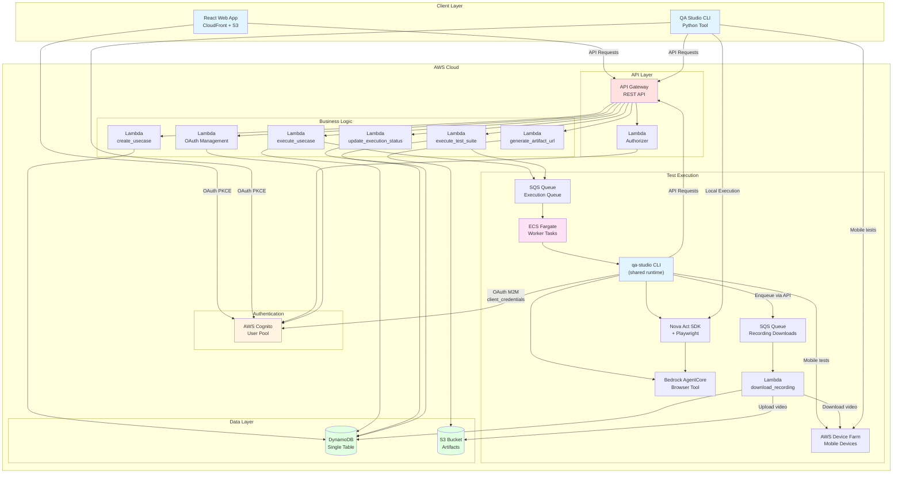
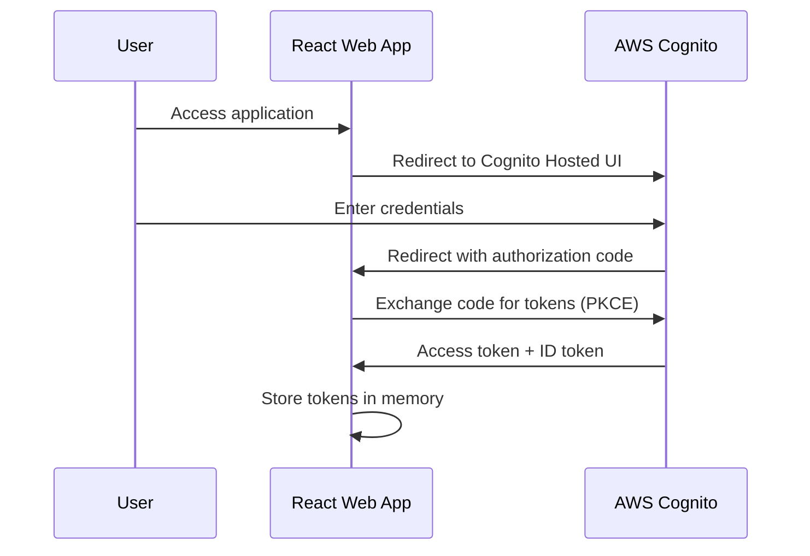
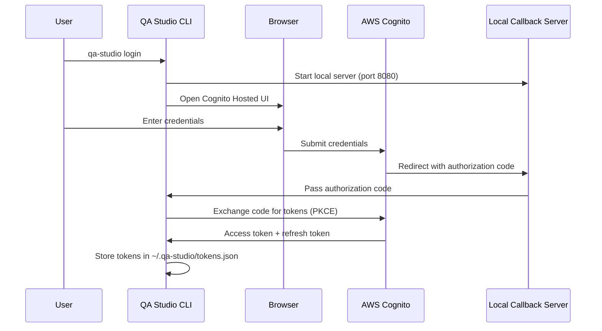
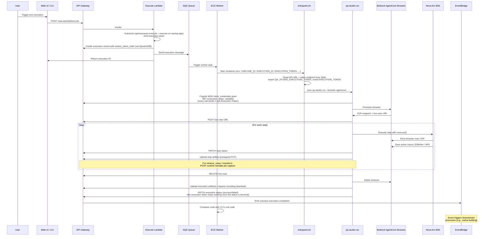
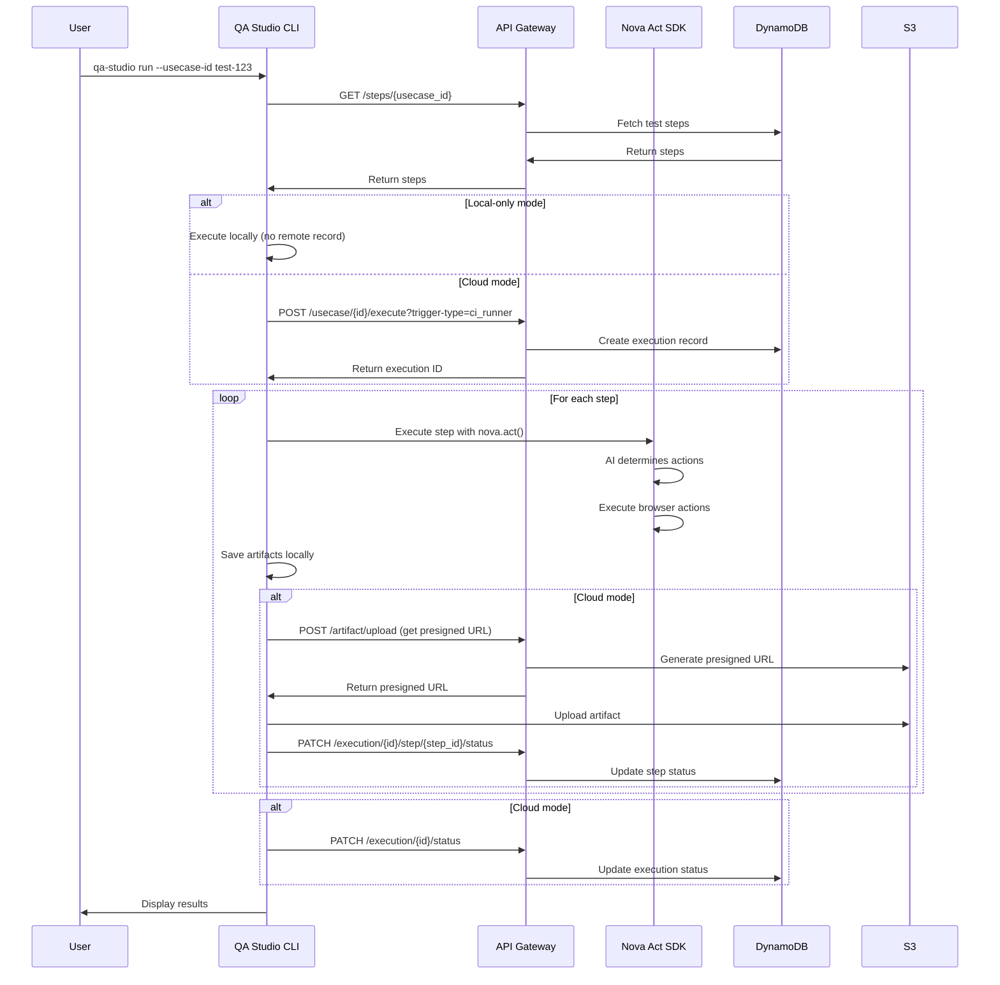
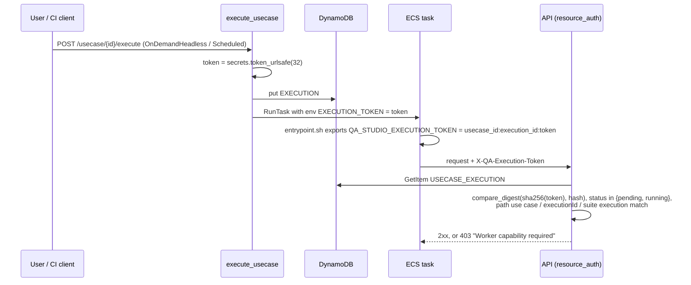

# Architecture Overview

## System Overview

QA Studio is a serverless web application for AI-powered automated testing built on Amazon Nova Act. The system consists of a React frontend, serverless API backend, ECS-based test execution workers, and a CLI tool. The `qa-studio` CLI is the single execution runtime: developer-run tests, CI-run tests, and cloud-triggered ECS worker tests all invoke the same code path.

**Key Capabilities**:
- Natural language test creation and management
- AI-powered browser automation with Amazon Nova Act
- Mobile app testing on real devices via AWS Device Farm
- Interactive test wizard with live browser preview
- Test suite organization and execution
- Comprehensive artifact capture (videos, screenshots, logs, traces)
- OAuth 2.0 authentication for users and API clients
- CLI tool for local test execution and management, and as the runtime for the cloud worker

---

## System Components



> **Note on the cloud worker**: batch ECS tasks run `qa-studio run` as their entrypoint (via the CLI-unified-runner refactor). The container reads execution context from ECS env vars, authenticates against Cognito using an M2M client whose credentials live in Secrets Manager, and writes all state back through the public API — the worker no longer talks to DynamoDB, S3, SQS or EventBridge directly for batch executions. Wizard-mode tasks still use the legacy `wizard_worker.py` path until the wizard migration lands (separate spec).

---

## Data Flow Diagrams

### Web UI Authentication Flow



### CLI Authentication Flow



### Test Execution Flow (Cloud)



### Test Execution Flow (Local CLI)



---

## Component Details

### Frontend (React Web App)

**Technology**: React 18, TypeScript, Vite, AWS Cloudscape Design System

**Hosting**: CloudFront (CDN) + S3 (static hosting)

**Key Features**:
- Test creation and management UI
- Interactive test wizard with live browser preview
- Test suite organization
- Execution history and artifact viewing
- OAuth client management
- User management

**Authentication**: OAuth 2.0 PKCE flow via Cognito Hosted UI

### CLI Tool (QA Studio CLI)

**Technology**: Python 3.11+, Click framework

**Installation**: `pip install -e ./qa-studio-cli[runner]`

**Key Features**:
- Browser-based OAuth authentication
- Test and suite management commands
- Local test execution with Nova Act (web and mobile)
- Mobile test execution via AWS Device Farm
- Configuration management
- Kiro IDE integration

**Authentication**: OAuth 2.0 PKCE flow with local callback server

### API Layer

**Technology**: Amazon API Gateway (REST API) + AWS Lambda (Python 3.11)

**Authentication**: 
- Lambda authorizer validates JWT tokens from Cognito and injects the caller identity (user, OAuth client or worker, with team roles)
- Scope-based authorization (e.g., `api/usecases.read`, `api/usecases.write`) plus team ownership on every resource route through `require_resource_access` (see [Authorization](#authorization))

**Key Endpoints**:
- `/usecases` - Test management (CRUD)
- `/steps` - Test step management
- `/suites` - Test suite management
- `/executions` - Execution management and triggering
- `/devices` - Device Farm device listing
- `/oauth-clients` - OAuth client management
- `/artifacts` - Artifact URL generation

### Test Execution (ECS Workers)

**Technology**: Amazon ECS with Fargate, Python 3.13, the `qa-studio` CLI (with `[runner,agentcore]` extras), Nova Act SDK, Playwright, Appium (mobile). Browser execution runs in Bedrock AgentCore, not inside the container.

**Trigger**: SQS messages from `execute_usecase` or `execute_test_suite` Lambdas.

**Container contract**:
- The worker image installs the `qa-studio` CLI from the sibling `qa-studio-cli/` package during Docker build.
- `entrypoint.sh` runs on container start.  It branches on `WORKER_MODE`:
  - `batch` (default) — resolves the API URL + Cognito token endpoint from SSM, reads OAuth client-credentials from env (injected by ECS from Secrets Manager), and execs `qa-studio run --browser agentcore …`.
  - `wizard` — defers to `wizard_worker.py` until the wizard migration lands.

**Execution Flow (Web, batch mode)**:
1. Entrypoint resolves `QA_STUDIO_API_URL` (SSM) and `OAUTH_TOKEN_ENDPOINT` (SSM), exports `OAUTH_CLIENT_ID` / `OAUTH_CLIENT_SECRET` from the ECS `secrets:` injection, and turns `EXECUTION_TOKEN` into `QA_STUDIO_EXECUTION_TOKEN="{usecase_id}:{execution_id}:{token}"` (then unsets `EXECUTION_TOKEN`).
2. `qa-studio run --browser agentcore --trigger-type worker` starts.
3. The CLI authenticates via Cognito M2M client-credentials and fetches execution details over the public API.
4. The AgentCore browser provisioner calls Bedrock to create + start a remote browser, returns CDP endpoint + live-view URL.
5. The runner publishes the live-view URL via the `live-view` endpoint so the frontend can show it.
6. For each step, the runner executes via NovaAct, posts step status + uploads artifacts via presigned PUT URLs, and (for `retrieve_value` / `transform` steps) publishes captured runtime variables per-capture.
7. The AgentCore browser + live-view record are torn down in the runner's `finally` block.
8. The runner uploads execution artifacts (and, for mobile, requests the recording download), then PATCHes the final execution status — the server-side `update_execution_status` Lambda emits the `usecase.execution.completed` EventBridge event. The order matters: the [worker execution token](#worker-execution-capability) is only valid while the execution is `pending` or `running`.

Every API call in steps 3-8 carries `X-QA-Execution-Token` (from `QA_STUDIO_EXECUTION_TOKEN`, exported by `entrypoint.sh`).

**Execution Flow (Mobile, batch mode)**:
1. Steps 1-3 as above.
2. Instead of provisioning an AgentCore browser, the CLI builds a `DeviceFarmActuator` and hands it to NovaAct (uploads the app binary to Device Farm if needed).
3. After the Device Farm session starts, the runner persists the session ARN via the `mobile-metadata` endpoint so the frontend can link to Device Farm.
4. Steps execute via the actuator; all state writes go through the API.
5. After the session stops, the runner posts the final session ARN and calls the `download-recording` endpoint which enqueues a delayed SQS message (5 min) for the recording download Lambda.

**Recording Download (Mobile)**:
- The `download_device_farm_recording` Lambda picks up the delayed SQS message, waits for the session to reach a terminal state, downloads the video, uploads it to S3, and creates a DynamoDB artifact record.
- If the session hasn't finalized yet, the Lambda raises an error and SQS retries after the visibility timeout.

**Execution Flow (Mobile)**:
1. Receive execution message from SQS
2. Fetch test steps from DynamoDB
3. Provision a Device Farm remote access session (uploads app binary if needed)
4. Connect to the device via Appium through the Device Farm endpoint
5. Initialize Nova Act with [`DeviceFarmActuator`](https://github.com/amazon-agi-labs/nova-act-samples/blob/main/examples/actuation/mobile/nova_act_mobile/actuation/device_farm_actuator.py)
6. Execute each step with `nova.act(instruction)`
7. Stop the Device Farm session and enqueue a delayed SQS message for recording download
8. Update execution status in DynamoDB
9. Emit EventBridge event for downstream processing

**Recording Download (Mobile)**:
- After the worker stops the Device Farm session, it sends a delayed SQS message (5 min) to the recording download queue
- A Lambda (`download_device_farm_recording`) picks up the message after the delay
- The Lambda waits for the session to reach a terminal state, downloads the video artifact from Device Farm, uploads it to S3, and creates a DynamoDB artifact record
- If the session hasn't finalized yet, the Lambda raises an error and SQS retries after the visibility timeout (3 min), up to 10 retries

**Event Emission**:
- `usecase.execution.completed` is emitted by the `update_execution_status` Lambda (`Source=qa-studio.api`) on every terminal status transition.
- Event detail: `usecase_id`, `execution_id`, `execution_status`, `timestamp`.
- Triggers downstream processes such as cache building for step optimization.

**Artifacts Generated**:
- Screenshots (PNG)
- Videos (MP4) — from AgentCore Browser (web) or Device Farm (mobile)
- Action traces (JSON and HTML)
- Execution logs (text)
- Trajectory JSONs (web) — persisted per step by the runner so subsequent runs can replay them without hitting Nova Act's LLM.

### Data Storage

**DynamoDB (Single Table Design)**:
- Primary Key: `pk` (partition key)
- Sort Key: `sk` (sort key)
- Access patterns optimized with GSIs

**Key Record Types**:
- `USECASE#{id}` / `METADATA` - Test metadata
- `USECASE#{id}` / `STEP#{id}` - Test steps
- `USECASE_EXECUTION#{usecase_id}` / `EXECUTION#{id}` - Execution records
- `EXECUTION#{id}` / `EXECUTION_STEP#{id}` - Execution step records
- `SUITE#{id}` / `METADATA` - Suite metadata
- `SUITE#{id}` / `USECASE#{id}` - Suite-usecase mappings

**Authorization attributes** (new attributes on existing records; no new record types or GSIs):

| Record (`pk` / `sk`) | Attribute | Type | Description |
|---|---|---|---|
| `OAUTH_CLIENTS` / `{client_id}` | `team_id` | String | Team the client is bound to. Required for new clients; a record without it is an unbound client and gets no team role (fail closed). |
| `OAUTH_CLIENTS` / `{client_id}` | `team_role` | String (`editor` \| `executor` \| `viewer`) | The client's role in `team_id`: the creator's role capped at `editor`. Any other value is ignored by the authorizer. |
| `USECASE_EXECUTION#{usecase_id}` / `EXECUTION#{execution_id}` | `worker_token_hash` | String (64-char lowercase hex) | SHA-256 of the worker execution token. Written by `execute_usecase` for `Scheduled` and `OnDemandHeadless` runs only; the token itself is never stored. |
| `USECASES` / `USECASE#{id}` | `application_id`, `owner_team_id` | String | Owner chain used by the resolvers. Now always stamped when a use case is created (create, import, wizard start, template apply, clone) and re-stamped when it moves to another app. |
| `USECASE#{id}` / `OVERRIDE` | `allowed_subs`, `allowed_roles` | List of String | Optional per-test-case visibility override (read only; no endpoint writes it yet). |

**Removed record:** `ADMIN_COUNT` / `GLOBAL` (the old team-admin counter). The last-admin guard now counts the `admins` Cognito group, and the team admin migration deletes the record.

**S3 Bucket**:
- Artifacts organized by execution ID
- Presigned URLs for secure uploads
- Lifecycle policies for cost optimization

---

## Security Architecture

### Authentication

**Users (Web UI + CLI)**:
- OAuth 2.0 Authorization Code flow with PKCE
- Cognito Hosted UI for login
- Access tokens (1 hour) + refresh tokens (30 days)

**API Clients (M2M)**:
- OAuth 2.0 Client Credentials flow
- Client ID + Client Secret
- Access tokens (1 hour, no refresh)

### Authorization

Authorization has two layers: OAuth scopes (what kind of operation) and team ownership (which resources). The role model and per-role rules are in [User Management](user-management.md); this section covers how they're enforced.

#### User journey

1. An Admin creates a team and adds members with team roles (`team_lead`, `editor`, `executor`, `viewer`). Admin itself is studio-wide and comes only from the `admins` group.
2. A Team Lead creates an application for their team. Editors create use cases and suites inside it; every new use case is stamped with the app's `application_id` and `owner_team_id`.
3. An Editor creates an OAuth client for CI and picks the team. The client acts as an Editor (or lower) of that team only.
4. An Executor (or the CI client) starts a run. `execute_usecase` checks execute on the owning app, creates the execution with a token hash and starts the worker, which may then act on that one execution until it finishes.
5. A user of another team who opens any of these resources by ID or link gets 403 (404 for an unknown ID, a mismatched use case/execution pair, or a use case hidden by a visibility override).

**Scope-Based Access Control**: scopes follow `api/{resource}.read|write` (plus `api/usecases.execute`, `api/teams.manage`, `api/admin`) and are derived from Cognito groups by `role_scopes.py`. The authoritative list is the API resource server in `web-app/lib/auth-stack.ts`; see the [scope table](api-reference.md#oauth-scopes).

**Lambda Authorizer** (`web-app/lambdas/auth/authorizer.py`):
- Validates the JWT signature and expiration; caches decisions for 5 minutes (API Gateway authorizer cache)
- **Users**: scopes and `isAdmin` come from Cognito groups. Only `admins` sets `isAdmin`; a `team-{id}-{role}` group adds a team role only when `role` is one of the four team roles (a legacy `team-{id}-admin` grants nothing)
- **Worker**: a client token whose `client_id` equals `WORKER_CLIENT_ID` gets `identityType=worker` and no team roles. It can only act through the execution capability below
- **OAuth clients**: `_lookup_client_binding` does a `GetItem` on `OAUTH_CLIENTS/{client_id}` (projection `team_id`, `team_role`) and emits `teamRoles=[{team_id, role}]`. Results are cached in the warm container for 60 seconds. A missing record, a missing `team_id`, a role outside `editor`/`executor`/`viewer`, or a lookup error emits `[]` (fail closed; errors aren't cached)
- `api/admin` and `api/teams.manage` are stripped from every client token
- IAM: `dynamodb:GetItem` on the table, restricted with `dynamodb:LeadingKeys = ["OAUTH_CLIENTS"]` (`lib/authorizer-client-binding.ts`)

#### Central resource check: `require_resource_access`

Every routed handler that touches a team-owned resource is wrapped by one decorator in `lambdas/endpoints/resource_auth.py`:

```python
@require_resource_access('execute', usecase_from_path,
                         scopes=['api/usecases.execute'], allow_worker=True)
def handler(event, context): ...
```

Order of checks:

1. `require_scopes(event, scopes)`: 403 before anything is read.
2. The **resolver** loads the owner chain with narrow `GetItem` projections (`permissions_repo`). It returns 400 for an invalid ID and 404 when the resource doesn't exist or doesn't belong to its parent.
3. **Worker** identity: 403 unless `allow_worker=True`, then the execution capability check.
4. Everyone else: `authorize_resource(identity, action, owner_team_id, ...)` with the ceiling rule for shared access. A record without `application_id` resolves to no owner, so only admins pass (orphans fail closed).
5. For `view` on a use case (and its executions), the per-test-case override; a hidden use case returns 404.

| Resolver | Path / body | Owner chain |
|---|---|---|
| `usecase_from_path` | `/usecase/{id}` | `USECASES/USECASE#{id}` → `application_id` → app `owner_team_id` |
| `execution_from_path` | `/usecase/{id}/executions/{executionId}` | `USECASE_EXECUTION#{id}/EXECUTION#{executionId}` must exist, then the use case |
| `suite_from_path` | `/test-suites/{suite_id}` | `TEST_SUITES/SUITE#{suite_id}` → app |
| `suite_execution_from_path` | `/test-suites/{suite_id}/executions/{execution_id}` | `SUITE_EXECUTION#{suite_id}/EXECUTION#{execution_id}` must exist, then the suite |
| `app_from_path` | `/applications/{id}` | `APPLICATION#{id}` `owner_team_id` |
| `app_from_body(field)` | body `application_id` | target app (create use case/suite, import, wizard start, template apply) |
| `usecase_from_body(field)` | body `usecaseId` | existing use case (`/generate-s3-url`) |
| `wizard_session_from_path` | `/wizard/{sessionId}/...` + `usecaseId` (path, query or body) | session execution record under the use case, then the use case |

Related helpers: `require_team_role` (team routes, OAuth client creation), `require_owner_team_lead` (application update/delete; owner team only, never via a share), `require_oauth_client_manager` (client delete/rotate), `authorize_target_app` (moving a use case or suite), `can_view_testcase_batch` (list filtering).

Two tests keep this from regressing: `test_route_coverage.py` parses `api-stack.ts` and the router and fails when a routed handler has neither the decorator nor an allowlist entry with a reason, and `test_cross_team_matrix.py` runs every routed handler against 12 identities (owner roles, other team, shares, admin, bound/unbound client, worker).

#### Worker execution capability

The worker shares one M2M client across all tasks, so its identity alone grants nothing. Each cloud run gets its own capability:



- Only routes the runner needs set `allow_worker=True`: reading the use case, steps, variables, secret keys and values, execution, execution steps, variables and headers; execution status, step status, runtime variables, live view (get/create/delete), execution and step artifact URLs, artifact confirmation, mobile metadata, recording download, trajectory upload/download URLs, suite execution status and suite artifact URLs. Wizard routes never allow the worker; `wizard_worker.py` talks to AWS directly.
- `ci_runner` and `OnDemand` runs get no token. A local `qa-studio run` uses the user's or CI client's own token and team role instead.
- The token expires with the execution: once the status is terminal, every worker call is denied.
- EventBridge schedules invoke `execute_usecase` / `execute_test_suite` without a `requestContext`. That path is IAM-only and skips the decorator; `Scheduled` runs still get a token.

#### Audit and access events

Structured JSON lines in the endpoint Lambda logs (CloudWatch Logs Insights):

| Event | Emitted by | Fields |
|---|---|---|
| `permission_change` / `app_base_url_change` | `update_application` when `base_url` changes | `actor {sub, client_id}`, `target {app_id, owner_team_id}`, `details {old, new}` |
| `permission_change` / `revoke_access` (reason `app_deleted`) | `delete_application`, per revoked grant | `actor`, `target {owner_team_id, target_team_id, app_id}`, `details {grant_id, reason}` |
| `secret_value_access` (plain log line) | `get_usecase_secret_value` | `type`, `sub`, `client_id`, `usecase`, `key` (never the value) |

Every `permission_change` line also carries `event_type`, `timestamp`, `action`.

### Data Protection

**Encryption at Rest**:
- DynamoDB: AWS-managed encryption
- S3: AES-256 encryption
- Secrets Manager: AWS-managed encryption

**Encryption in Transit**:
- TLS 1.2+ for all API communication
- HTTPS-only CloudFront distribution

**Secret Management**:
- Test secrets stored in AWS Secrets Manager
- Referenced by secret key in test steps
- Retrieved at execution time only

### Infrastructure Compliance (cdk-nag)

All CDK stacks are validated at synth time using [cdk-nag](https://github.com/cdklabs/cdk-nag) with the `AwsSolutionsChecks` rule pack. This runs automatically during every `cdk synth` and `cdk deploy`.

- Rules are applied via `Aspects.of(app).add(new AwsSolutionsChecks(...))` in `bin/cdk.ts`
- Known acceptable patterns are suppressed with documented reasons in `lib/cdk-nag-suppressions.ts`
- Legacy cfn_nag suppressions for CDK-managed resources live in `lib/cfn-nag-suppressions.ts`
- Any new resource that violates an AwsSolutions rule will surface as an error annotation during synth

---

## Scalability & Performance

### API Layer
- API Gateway: Auto-scales to handle request volume
- Lambda: Concurrent execution limit (default 1000)
- DynamoDB: On-demand capacity mode

### Test Execution
- ECS: Auto-scales based on SQS queue depth
- Parallel execution: Multiple workers process tests simultaneously
- SQS: Buffers execution requests during high load

### Artifact Storage
- S3: Unlimited storage capacity
- CloudFront: Global CDN for fast artifact access
- Presigned URLs: Direct uploads bypass API Gateway limits

---

## Monitoring & Observability

### CloudWatch Logs
- API Gateway access logs
- Lambda function logs
- ECS task logs
- Worker execution logs

### CloudWatch Metrics
- API request count and latency
- Lambda invocation count and duration
- ECS task count and CPU/memory usage
- SQS queue depth and message age

### X-Ray Tracing
- End-to-end request tracing
- Service map visualization
- Performance bottleneck identification

---

## Cost Optimization

### Compute
- Lambda: Pay per invocation (sub-second billing)
- ECS Fargate: Pay per task execution time
- API Gateway: Pay per request

### Storage
- S3: Lifecycle policies to transition old artifacts to Glacier
- DynamoDB: On-demand pricing for variable workloads

### Data Transfer
- CloudFront: Reduced data transfer costs
- S3 presigned URLs: Direct uploads avoid API Gateway costs

---

## Disaster Recovery

### Backup Strategy
- DynamoDB: Point-in-time recovery enabled
- S3: Versioning enabled for critical artifacts
- CloudFormation: Infrastructure as code for rapid rebuild

### High Availability
- Multi-AZ deployment for all services
- CloudFront: Global edge locations
- API Gateway: Built-in redundancy

---

## Future Enhancements

- Test result analytics and trends
- Slack/email notifications
- Test result comparison
- Performance testing support
- Android emulator support for local mobile testing
- Device Farm session live streaming
