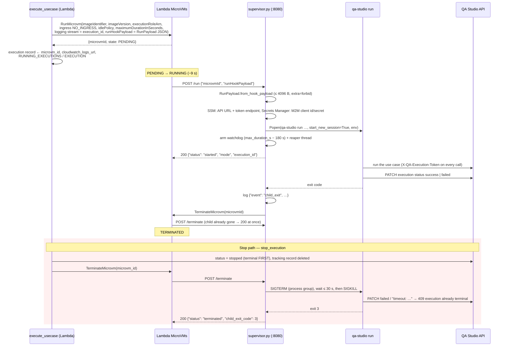

# Worker: Nova Act Test Execution Container

The worker is the image that runs cloud test executions as a **Lambda MicroVM** per execution (design: `.kiro/docs/microvm-runner/design.md`). Since the CLI-unified-runner refactor the image is a thin shell around the `qa-studio` CLI: `supervisor.py` is the image `ENTRYPOINT`, answers the platform's lifecycle hooks and spawns `qa-studio run` from the `/run` payload. The CLI performs all test execution, talks to the public API for state changes, and uploads artifacts via presigned URLs.

Wizard sessions (interactive step-by-step execution with a persistent browser) run on the same image: the supervisor spawns the legacy `wizard_worker.py` for `mode: wizard`. De-duplicating that path with the CLI is tracked in a separate spec (`.kiro/specs/wizard-migration/`).

**History.** Until the microvm-runner feature the same image ran as an ECS Fargate task inside a VPC, with `entrypoint.sh` translating task env vars into CLI flags; cluster, ECR, the worker VPC and `entrypoint.sh` are gone, and `supervisor.py` is the only entrypoint. The VM itself is never in a VPC; only the AgentCore browser can be (config `vpcId`).

See [`docs/architecture.md`](../../docs/architecture.md) for the full cross-stack picture and execution sequence diagrams.

## VM Lifecycle

```
RunMicrovm (execute_usecase / start_wizard_session)
      │
      ▼
supervisor.py (ENTRYPOINT, :8080) receives POST /run {microvmId, runHookPayload}
      │
      ├── mode=batch
      │       resolve API URL + Cognito token endpoint from SSM,
      │       OAUTH_CLIENT_ID/SECRET from Secrets Manager (execution role)
      │       spawn qa-studio run --browser agentcore \
      │           --usecase-id $USECASE_ID \
      │           --execution-id $EXECUTION_ID \
      │           --region $AWS_REGION
      │
      └── mode=wizard
              spawn python wizard_worker.py        (legacy path)
```

## Authentication (Batch Mode)

The CLI authenticates against Cognito using OAuth 2.0 Client Credentials flow. Credentials come from the auth stack:

- The auth stack provisions a dedicated M2M `UserPoolClient` and stores `{client_id, client_secret}` in Secrets Manager.
- The supervisor reads that secret (`WORKER_CREDENTIALS_SECRET_ARN`) inside `/run` under the VM's execution role and exports `OAUTH_CLIENT_ID` / `OAUTH_CLIENT_SECRET` to the child.
- The Cognito token endpoint and the API URL are published to SSM parameters; the supervisor reads both before starting the CLI.

The CLI's `TokenResolver` picks up `OAUTH_CLIENT_ID` / `OAUTH_CLIENT_SECRET` / `OAUTH_TOKEN_ENDPOINT` from env automatically.

## File Layout

```
worker/
├── Dockerfile                # Multi-stage: installs qa-studio[runner,agentcore]; ENTRYPOINT supervisor.py
├── supervisor.py             # MicroVM lifecycle hooks → child process
├── supervisor_models.py      # RunPayload (pydantic); shared with the launcher Lambda
├── wizard_worker.py          # Wizard mode only (legacy)
├── recording_controller.py   # Wizard mode only
├── extension_helper.py       # Wizard mode only
├── *_step.py, browser.py,    # Wizard step execution (navigation, validation,
│   transform/, …             #   assertion, retrieve_value, secret, download, url)
├── requirements.txt          # Python deps for wizard_worker + CLI runtime
├── tests/                    # pytest suite for the wizard modules, the Dockerfile contract and the supervisor
└── README.md                 # this file
```

Every Python module here is reachable from `wizard_worker.py`. The old batch worker (`worker.py`) and the
modules only it used (`browser_step`, `network_assertion_step`, `network_matcher`, `event_emitter`,
`mobile_actuator`, `trajectory_manager`, `transform_step`, a vendored `nova_act_mobile/`) were removed: batch runs
are `qa-studio run`, and the canonical `nova_act_mobile` package lives in `qa-studio-cli/`.

Batch-mode Python (dispatcher, step executors, trajectory manager, browser provisioning) lives in `qa-studio-cli/` and is installed into the image via `pip install /build/qa-studio-cli[runner,agentcore]` at image build time. The build context is the **repo root** so the Dockerfile can COPY both `web-app/worker/` and the sibling `qa-studio-cli/` package; `.dockerignore` at the repo root filters the MicroVM code artifact (`web-app/lib/worker-image-asset.ts`).

## Running the Tests Locally

The wizard step modules import the CLI's transform package (`qa_studio_cli.runner.transform`: date parsing,
date assertions) — the image gets it from `pip install qa-studio-cli[runner,agentcore]`. Locally, install the CLI
into the same environment before running the worker tests:

```bash
pip install -e "./qa-studio-cli[runner]"
cd web-app/worker && python3 -m pytest tests
```

## Environment Variables

The image has two layers: image-level env (stack constants, baked into the snapshot by the worker stack) and the per-execution `RunPayload` the supervisor turns into the child's env. Both are listed under [Payload vs image env](#payload-vs-image-env) below. Settings read by the CLI itself:

| Variable | Default | Purpose |
|---|---|---|
| `AWS_REGION` | platform-injected | Forwarded to `qa-studio run --region` in batch mode |
| `ENABLE_TRAJECTORY_REPLAY` | `true` | Set to `false` to skip trajectory replay for navigation steps |
| `AGENT_CORE_VPC` | unset (PUBLIC) | `true` attaches the AgentCore browser to a VPC (`networkMode: VPC`); set by the stack only when config `vpcId` is set |
| `AC_VPC_ID` / `AC_SUBNET_IDS` / `AC_SECURITY_GROUP_ID` | — | Required when `AGENT_CORE_VPC=true`; `AC_SUBNET_IDS` is comma-separated, every subnet is passed to `create_browser`. A missing one fails the run before any AWS call |
| `USE_NOVA_ACT_GA` | `true` | Selects Nova Act GA Workflow (`true`) vs preview API (`false`) |
| `NOVA_ACT_API_KEY_NAME` | — | Secrets Manager secret name, required when `USE_NOVA_ACT_GA=false` |
| `NOVA_ACT_S3_BUCKET` | — | S3 bucket used by Nova Act Workflow storage |

The CLI is always invoked with `--verbose`: the VM's console output is the CloudWatch log stream, so the full runner logging (API calls, engine internals, Nova Act think/act trace) must be there. There is no opt-out.

## Build and Deploy

One image, built by Lambda MicroVMs from an S3 zip of the `.dockerignore`-filtered repo root (`WorkerImageAsset`, Dockerfile copied to the zip root) on base `al2023-1` v2. Nothing is needed locally — bundling is a file copy, **no Docker or Podman** — and the result is the `AWS::Lambda::MicrovmImage` `<baseName>-worker` (build 3–5 min, CloudFormation waits; logs in `/qa-studio/<baseName>/microvm` stream `<version>/<build-id>`; the image `Description` is the `web-app/package.json` version).

Deploy with:

```bash
cd web-app
npm run deploy:worker
```

For a fresh build of everything:

```bash
npm run deploy
```

The image zip (and therefore the MicroVM build) is only re-uploaded when files under `web-app/worker/` or `qa-studio-cli/` change (asset hash of the filtered tree).

See [`docs/development.md`](../../docs/development.md) for the full list of `npm run deploy:*` targets.

## MicroVM supervisor

`supervisor.py` is the image `ENTRYPOINT` (`python /app/supervisor.py`), a stdlib HTTP server on port 8080 that answers the platform's lifecycle hooks and owns exactly one child process per VM. Nothing in the module creates a boto3 client, random value or socket at import time: the image snapshot captures the running server, and every VM is cloned from it.

### Lifecycle



A `/run` that fails (400 invalid payload, 409 second call, 500 missing image env / SSM / secret / spawn error) also calls `TerminateMicrovm` on the VM so a VM never idles without a child. The execution record is then never updated by a runner; the reconciler (`reconcile_executions`, every 5 min) finds the `TERMINATED` VM through `RUNNING_EXECUTIONS` and marks the execution `failed` with `reconciler: <reason>`.

### Hooks

All hooks are `POST /aws/lambda-microvms/runtime/v1/<hook>`; responses are JSON.

| Hook | Behaviour | Response |
|---|---|---|
| `ready`, `validate` | Runs `qa-studio --help` (the CLI has no `--version`); proves the console script, venv and import graph work. Image build time only. | `200 {"status":"ready"}` / `503 {"status":"not_ready"}` |
| `run` | Parses `{"microvmId", "runHookPayload"}`, validates the payload (`RunPayload`), resolves credentials, spawns the child in its own process group, arms the watchdog, returns at once (platform limit 60 s, target < 2 s). | `200 {"status":"started","mode","execution_id"}`; `400` invalid payload; `409` second call; `500` image env / AWS config error. Every non-200 also calls `TerminateMicrovm` on the VM. |
| `terminate` | SIGTERM to the child's group, waits ≤ 30 s, SIGKILL if still alive. | `200 {"status":"terminated","child_exit_code"}` |
| `suspend`, `resume` | Never expected (the launcher sets `maxIdleDurationSeconds` to the VM's maximum duration), but must not wedge a misconfigured launch. | `200` |

Watchdog: `max_duration_s − 180 s` after spawn the child's group gets SIGTERM, SIGKILL 30 s later. When the child exits for any reason the supervisor logs one JSON line (`{"event":"child_exit","mode","execution_id","exit_code","duration_s","microvm_id"}`) and calls `lambda-microvms:TerminateMicrovm` on itself (needs `boto3>=1.43.35`). Exit codes are logged, not interpreted; the runner uses `143` for `terminated` and `3` for `timeout`. If `/terminate` was the trigger, the self-terminate call is skipped (the platform is already terminating the VM).

### Termination reason

`qa-studio run` reads `QA_STUDIO_TERMINATION_REASON` / `QA_STUDIO_MAX_DURATION_SECONDS` from its own env *when SIGTERM arrives*, and a running child's env cannot be changed. The supervisor therefore spawns every batch child with `QA_STUDIO_TERMINATION_REASON=timeout` and `QA_STUDIO_MAX_DURATION_SECONDS=<max_duration_s>`. This is correct because the MicroVM has exactly two SIGTERM sources: (a) the watchdog soft timeout and (b) the `/terminate` hook. (b) is reached either by the platform's `maximumDurationInSeconds` kill (a timeout too) or by `stop_execution`, which writes the terminal `stopped` status *before* calling `TerminateMicrovm`, so the server rejects the runner's late `failed/timeout` PATCH. A SIGTERM that does reach the execution record is, by construction, a timeout.

### `RunPayload` (`supervisor_models.py`)

Shared by the launcher Lambda (`lambdas/endpoints/run_payload.py`, a byte-identical vendored copy guarded by `test_run_payload_parity.py`; edit this module, then `cp` it over) and the supervisor; pydantic only, no other imports. `RunPayload.to_hook_payload()` produces the compact JSON string for `RunMicrovm(runHookPayload=…)`, `RunPayload.from_hook_payload(raw)` parses it. The serialised size must stay ≤ 4096 bytes (`RUN_HOOK_PAYLOAD_MAX_BYTES`, the platform limit, enforced both ways). Unknown keys are rejected.

| Field | Type | Required | Source (launcher) | Purpose |
|---|---|---|---|---|
| `mode` | `"batch"` \| `"wizard"` | yes | constant `batch` (`execute_usecase`); `wizard` in phase 2 | Selects `qa-studio run …` or `python wizard_worker.py` |
| `usecase_id` | str | yes | path parameter | `USECASE_ID` |
| `execution_id` | str | batch | the execution record just created (uuid7) | `EXECUTION_ID`, `--execution-id` |
| `execution_token` | `SecretStr` | batch | `new_worker_token()`; only its SHA-256 is stored on the record | Raw worker capability → `QA_STUDIO_EXECUTION_TOKEN={usecase_id}:{execution_id}:{token}`; never logged or dumped |
| `session_id` | str | wizard | wizard session (phase 2) | `SESSION_ID` |
| `region` | str | yes | use case `executing_region`, else `DEFAULT_REGION` | Executing region; selects the artefact bucket (the VM itself always runs in the stack region) |
| `s3_bucket` | str | yes | `{S3_BUCKET_PREFIX}-{region}` | `S3_BUCKET` (regional artefact bucket) |
| `user_agent` | str | no | Lambda env `USER_AGENT`, omitted when empty | Overrides the image-level `USER_AGENT` |
| `max_duration_s` | int, 1–28800 | yes | `MAX_EXECUTION_DURATION_MINUTES × 60` (config `maxExecutionDurationMinutes`) | The VM's `maximumDurationInSeconds`; drives the watchdog and `QA_STUDIO_MAX_DURATION_SECONDS` |
| `mobile` | `MobileConfig` | no (mobile use cases only) | non-empty use-case attributes `platform`, `app_package`, `app_activity`, `bundle_id`, `app_binary_s3_path`, `app_arn`, `device_farm_project_arn`, `device_arn` | Every non-empty field is exported upper-cased, plus `DEVICE_FARM_REGION` |

### Payload vs image env

Per-execution values travel in the payload; stack constants are image-level env vars (baked into the snapshot, so nothing per-execution or secret may live there). The child inherits the whole image env plus the values below.

| Child env var | Source | Mode |
|---|---|---|
| `EXECUTION_ID`, `USECASE_ID`, `S3_BUCKET`, `QA_STUDIO_EXECUTION_TOKEN`, mobile fields | payload | batch |
| `SESSION_ID`, `USECASE_ID`, `S3_BUCKET` | payload | wizard |
| `USER_AGENT` | payload override, else image env, else `""` | batch |
| `QA_STUDIO_TERMINATION_REASON=timeout`, `QA_STUDIO_MAX_DURATION_SECONDS` | supervisor | batch |
| `QA_STUDIO_API_URL`, `OAUTH_TOKEN_ENDPOINT` | SSM parameters named by `QA_STUDIO_API_URL_SSM`, `QA_STUDIO_TOKEN_ENDPOINT_SSM` (resolved inside `/run`) | batch |
| `OAUTH_CLIENT_ID`, `OAUTH_CLIENT_SECRET` | Secrets Manager secret `WORKER_CREDENTIALS_SECRET_ARN` (`{"client_id","client_secret"}`, resolved inside `/run`) | batch |
| `DYNAMODB_TABLE_NAME`, `S3_BUCKET_PREFIX`, `SECRETS_PREFIX`, `NOVA_ACT_API_KEY_NAME`, `BEDROCK_EXECUTION_ROLE` | image env (required; `/run` → 500 if missing) | batch |
| `AWS_REGION` | **platform-injected at VM start** (reserved image key — setting it on the image is a `ValidationException`); required by the supervisor, used for `--region` | batch |
| `AWS_DEFAULT_REGION` | copied from `AWS_REGION` by the supervisor (`ensure_default_region`) for itself and the child — botocore reads only this one and raises `NoRegionError` otherwise | batch, wizard |
| `WIZARD_QUEUE_URL`, `DYNAMODB_TABLE_NAME`, `BEDROCK_EXECUTION_ROLE`, `NOVA_ACT_API_KEY_NAME` | image env (required) | wizard |
| `DEVICE_FARM_REGION` | image env, else `us-west-2` (today's hard-coded value) | batch, mobile only |

#### Image-level environment (`lib/worker-stack.ts`, `microvmEnvironment`)

Baked into the snapshot by the `AWS::Lambda::MicrovmImage`; changing a value rebuilds the image (3–5 min). Stack constants only.

| Variable | Value | Read by |
|---|---|---|
| `QA_STUDIO_API_URL_SSM` | `/qa-studio/<baseName>/api-url` | supervisor (`/run`) |
| `QA_STUDIO_TOKEN_ENDPOINT_SSM` | `/qa-studio/<baseName>/cognito-token-endpoint` | supervisor (`/run`) |
| `QA_STUDIO_API_STAGE` | API deployment stage | CLI |
| `WORKER_CREDENTIALS_SECRET_ARN` | worker M2M credentials secret | supervisor (`/run`) |
| `BEDROCK_EXECUTION_ROLE` | AgentCore execution role ARN | CLI (AgentCore browser) |
| `DYNAMODB_TABLE_NAME`, `DYNAMO_TABLE` | the single table | CLI / wizard |
| `S3_BUCKET`, `S3_BUCKET_PREFIX` | default-region artefact bucket, `<account>-<baseName>-artefacts` | CLI (the per-execution `S3_BUCKET` from the payload overrides) |
| `SECRETS_PREFIX` | `<baseName>` | CLI secrets client |
| `NOVA_ACT_API_KEY_NAME`, `USE_NOVA_ACT_GA`, `NOVA_ACT_REGION`, `NOVA_ACT_S3_BUCKET` | Nova Act settings (`USE_NOVA_ACT_GA` from config; region `us-east-1`) | CLI |
| `DEVICE_FARM_REGION` | `us-west-2` | supervisor → child (mobile) |
| `NOTIFICATION_QUEUE_URL`, `RECORDING_QUEUE_URL`, `WIZARD_QUEUE_URL` | worker-stack queues | CLI / wizard |
| `NETWORK_ASSERTION_BODY_MAX_BYTES` | config `networkAssertionBodyMaxBytes` | CLI |
| `ENABLE_TRAJECTORY_REPLAY` | `true` | CLI |
| `AGENT_CORE_VPC`, `AC_VPC_ID`, `AC_SUBNET_IDS`, `AC_SECURITY_GROUP_ID` | only when config `vpcId` is set (`lib/browser-vpc.ts`) | CLI and wizard (`build_browser_config` in `qa_studio_cli/runner/browser/agentcore.py`; `browser.py` calls it) |

Injected by the platform at VM start, never set on the image: `AWS_REGION` (not `AWS_DEFAULT_REGION` — the supervisor derives that), `AWS_LAMBDA_MICROVM_IMAGE_NAME`, `AWS_LAMBDA_MICROVM_IMAGE_VERSION`, `AWS_LAMBDA_MICROVM_IMAGE_ARN`. AWS credentials come from the VM execution role (`assumed-role/<baseName>-microvm-execution-role/Lambda-microvmsExecutor-<microvmId>`), no env vars involved.

Batch command line: `qa-studio run --usecase-id … --execution-id … --browser agentcore --format json --verbose --region $AWS_REGION`. Supervisor-only settings: `SUPERVISOR_BIND_HOST` (default `0.0.0.0` — the VM runs with the `NO_INGRESS` connector and the only client is the platform's hook delivery), `SUPERVISOR_PORT` (default `8080`), `SUPERVISOR_LOG_LEVEL` (default `INFO`; `DEBUG` prints the child env with `OAUTH_CLIENT_SECRET` and `QA_STUDIO_EXECUTION_TOKEN` masked), `WORKER_APP_DIR` (default `/app`), `MICROVM_ID` (fallback when the `/run` body carries no `microvmId`).

### Local repro

Run the image with loopback-only port publishing and AWS credentials that can read the two SSM parameters and the M2M secret (the VM's execution role does this in production). `AWS_REGION` is passed explicitly here because the platform normally injects it:

```bash
docker build -f web-app/worker/Dockerfile -t qa-studio-worker .   # context = repo root

docker run --rm -p 127.0.0.1:8080:8080 \
  -e AWS_REGION=eu-central-1 -e AWS_ACCESS_KEY_ID -e AWS_SECRET_ACCESS_KEY -e AWS_SESSION_TOKEN \
  -e QA_STUDIO_API_URL_SSM=/qa-studio/<baseName>/api-url \
  -e QA_STUDIO_TOKEN_ENDPOINT_SSM=/qa-studio/<baseName>/cognito-token-endpoint \
  -e WORKER_CREDENTIALS_SECRET_ARN=arn:aws:secretsmanager:...:secret:<baseName>-worker-m2m-credentials-... \
  -e DYNAMODB_TABLE_NAME=... -e S3_BUCKET_PREFIX=... -e SECRETS_PREFIX=... \
  -e NOVA_ACT_API_KEY_NAME=... -e BEDROCK_EXECUTION_ROLE=... \
  qa-studio-worker

curl -XPOST http://127.0.0.1:8080/aws/lambda-microvms/runtime/v1/ready

# The execution must exist and be pending/running (create it with POST /usecase/{id}/execute?trigger-type=ci_runner,
# or use the id of a cloud execution); the token must match the record's worker_token_hash for the
# worker capability to work — for a local repro run the CLI with a user token instead if you have no raw token.
PAYLOAD=$(python3 -c 'import json,sys; sys.path.insert(0,"web-app/worker"); from supervisor_models import RunPayload
print(json.dumps({"microvmId": "local", "runHookPayload": RunPayload(mode="batch", usecase_id="<usecase>", execution_id="<execution>", execution_token="<token>", region="eu-central-1", s3_bucket="<prefix>-eu-central-1", max_duration_s=3600).to_hook_payload()}))')
curl -XPOST -H 'Content-Type: application/json' -d "$PAYLOAD" http://127.0.0.1:8080/aws/lambda-microvms/runtime/v1/run

curl -XPOST http://127.0.0.1:8080/aws/lambda-microvms/runtime/v1/terminate
```

Locally the self-terminate call fails (there is no MicroVM) and is logged as `TerminateMicrovm(local) failed: …`; everything else — SSM/secret resolution, child env, watchdog, graceful stop — behaves as in the VM. Without Docker: `cd web-app/worker && WORKER_APP_DIR=$PWD python3 supervisor.py --host 127.0.0.1 --port 8080`. The supervisor's unit tests (`web-app/worker/tests/test_supervisor.py`) run with a fake `Popen`, fake boto3 clients and shrunken `SupervisorTiming`, so no AWS access is needed for them.

## Running Locally

The unified runner means you can drive an execution from your laptop without the container. See [`docs/development.md` → Running the Unified Runner Locally](../../docs/development.md#running-the-unified-runner-locally) for:

- Running against a deployed stack with `qa-studio run`.
- Attaching to a pre-created execution with `--execution-id`.
- Reproducing the worker image locally with `docker run` (the MicroVM supervisor, [above](#local-repro)).

## Event Emission

After the CLI finishes a batch execution, it PATCHes the final execution status through the API. The existing `update_execution_status` Lambda emits the `usecase.execution.completed` EventBridge event (`Source=qa-studio.api`). The container no longer talks to EventBridge directly.

Event payload is unchanged:

```json
{
  "Source": "qa-studio.api",
  "DetailType": "usecase.execution.completed",
  "Detail": {
    "usecase_id": "uc_abc123",
    "execution_id": "exec_xyz789",
    "execution_status": "success",
    "timestamp": "2026-04-30T14:32:45.123456Z"
  }
}
```

## Trajectory Replay

When NovaAct is built with `replayable=True` support, the CLI records a trajectory JSON for each successful navigation step and persists it via the API's trajectory-upload-URL endpoint. On subsequent runs, the runner requests the download URL, replays the trajectory via NovaAct's internal `ProgramRunner`, and skips the LLM call. Typical speedup: 5–10×.

Replay failures fall through to a fresh Nova Act call and clear the stale pointer via the `clear_cache_fields` extension on the step-status endpoint.

Controlled by `ENABLE_TRAJECTORY_REPLAY` (default `true`).

## Troubleshooting

MicroVM-specific symptoms (image build failed, VM never reaches `RUNNING`, execution stuck, quota errors) are in [`docs/troubleshooting.md` → MicroVM worker](../../docs/troubleshooting.md).

### `image env for credential resolution is missing`

The supervisor (`/run` → 500) couldn't resolve the API URL. Check:
1. The `QA_STUDIO_API_URL_SSM` env var is set by worker-stack.ts and points at a parameter path like `/qa-studio/{baseName}/api-url`.
2. The api-stack has been deployed (it writes the parameter).
3. The MicroVM execution role has `ssm:GetParameter` on that parameter ARN.

### `Secrets Manager read failed for …`

The supervisor could not read the M2M credentials secret. Check:
1. The `${baseName}-worker-m2m-credentials` secret exists in Secrets Manager.
2. The secret value is valid JSON with `client_id` and `client_secret` fields.
3. The MicroVM execution role has `secretsmanager:GetSecretValue` on the secret ARN.

### CLI authentication errors

Look for the token endpoint in the VM log stream; the supervisor logs it at `SUPERVISOR_LOG_LEVEL=DEBUG` with secrets masked. Confirm the Cognito app client is configured with `clientCredentials` flow and has the `api/executions.read` + `api/executions.write` scopes.

### Wizard mode

Wizard sessions run as `python wizard_worker.py` under the same supervisor (`mode: wizard`). If wizard-mode tests fail, check the VM's CloudWatch stream (`cloudwatch_logs_url` on the execution record), the DynamoDB items under `EXECUTION#{sessionId}`, and the wizard command records.

**Termination.** `terminate_wizard_session` makes the execution record terminal *first* — one conditional write `status = success, wizard_status = closed, completed_at` (only while `pending` / `running`; an already `failed` / `timeout` record keeps its status and only gets `wizard_status` / `completed_at`) — then sends the `terminate` command, then calls `TerminateMicrovm` and deletes the `RUNNING_EXECUTIONS` item. The platform's `/terminate` hook SIGTERMs the worker within seconds, usually before it polls the command, so the worker cannot be relied on to write `success` itself (the terminate command alone used to be enough when the worker outlived it). `wizard_worker.py` installs `utils.install_sigterm_exit`, which turns SIGTERM into `SystemExit(143)`: a `BaseException`, so neither the command loop's nor the outer `except Exception` catches it (nothing writes `failed`) and the `finally` cleanup runs — `nova.close()`, `browser.stop()`, `delete_browser()`, `delete_live_view()`. In the VM log you see either the graceful path (`Terminating wizard session - starting graceful shutdown` … `Graceful shutdown complete`) or `SIGTERM received - exiting with code 143 so cleanup runs` → `Running final cleanup...`; the supervisor logs `child_exit` with `exit_code: 143`. The inactivity timeout (30 min) writes `timeout` itself, which is in `execution_transitions.TERMINAL_STATUSES`, so the reconciler only drops the tracking record and never marks a timed-out session `failed`.
